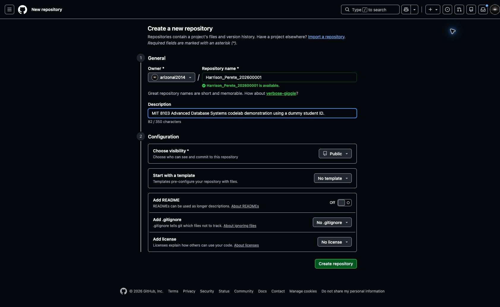
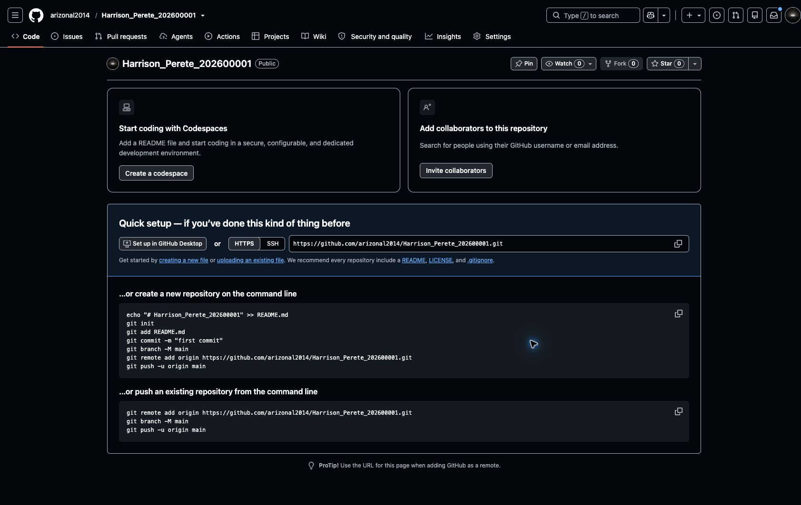

# Step 1 Create your assessment repository

## What the assessment asks for

Section 5, **GitHub Repository Requirements**, of the [assessment brief](https://lms-assets.miva.university/course-materials/mit-8103-advanced-database-systems-ca-september-cohort-2026.pdf) asks you to create a private GitHub repository. It should contain your scripts, database models, outputs, screenshots and documentation, added progressively as you work. Section 6 requires the assessor to have access before submission.

We will create the repository first so you have somewhere to save each portfolio activity.

## Your names and folder structure

The LMS submission instructions require the submission folder to use `Surname_Firstname_StudentID`, and uploaded files to use `Surname_Firstname_StudentID_DocumentType`.

For this demonstration, we will use:

| Detail | Demonstration value |
| --- | --- |
| First name | Perete |
| Surname | Harrison |
| Student ID | 202600001 — dummy ID for this tutorial |
| Submission folder | Harrison_Perete_202600001 |
| Repository name | Harrison_Perete_202600001 |
| Example filename | Harrison_Perete_202600001_README.md |

**Replace the demonstration name and ID with your own.** Using the submission folder name for the repository keeps the naming consistent; the brief does not prescribe that exact repository name. Your GitHub username can be different.

Section 5 suggests organising the five portfolios into separate directories. We will build this structure as we continue:

```text
Harrison_Perete_202600001/
├── Harrison_Perete_202600001_README.md
├── portfolio-1-database-design/
├── portfolio-2-query-optimisation/
├── portfolio-3-transactions-concurrency/
├── portfolio-4-nosql/
└── portfolio-5-distributed-cloud/
```

You do not need to create these files or folders yet.

## Create a GitHub account or sign in

GitHub stores your project files and records changes to them. A repository is the project space where you keep those files.

If you do not have an account:

1. Open [GitHub sign-up](https://github.com/signup).
2. Follow the registration prompts and choose a username.
3. Complete the requested account and email verification.
4. Sign in to GitHub.

If you already have an account, [sign in](https://github.com/login) and continue below.

**What you should see:** your signed-in GitHub dashboard, with your account menu in the upper-right corner. You should no longer be on the sign-up page.

## Create an empty repository

1. Open [Create a new repository](https://github.com/new).
2. Under **Owner**, select your own account.
3. Enter your repository name using your own details. Our demonstration uses `Harrison_Perete_202600001`.
4. Optionally enter the description: `MIT 8103 Advanced Database Systems practical portfolio`.
5. Select **Private** for your assessment repository, as required by Section 5 (make it public as per require instructed). The instructor's teaching repository will be **Public** so everyone can follow the demonstration.
6. Leave **Start with a template** set to **No template**, **Add README** set to **Off**, **Add .gitignore** set to **No .gitignore**, and **Add license** set to **No license**.
7. Click **Create repository**.

The demonstration settings below show the name, owner and Public visibility before clicking Create repository. Select your own account as Owner; `arizonal2014` is the instructor's GitHub username.



**What you should see:** your new repository page, with its owner and repository name at the top and a **Quick setup** section. It is empty because you have not added any files yet.



You can view the [demonstration repository](https://github.com/arizonal2014/Harrison_Perete_202600001). It will gain files as we continue; the screenshot above records how it looked immediately after creation.

## Check before continuing

- The repository belongs to your GitHub account.
- Its name uses your own surname, first name and student ID.
- Its visibility is Private for your assessment, or Public for the instructor's demonstration.
- The repository is empty and shows Quick setup.

Keep the repository page open. Continue to [Step 2 — Open your workspace in GitHub Codespaces](02_Open_Codespaces.md).

## GitHub help

- [Creating a GitHub account](https://docs.github.com/en/enterprise-cloud@latest/account-and-profile/how-tos/account-management/creating-an-account-on-github)
- [Creating a repository](https://docs.github.com/en/repositories/creating-and-managing-repositories/creating-a-new-repository)
