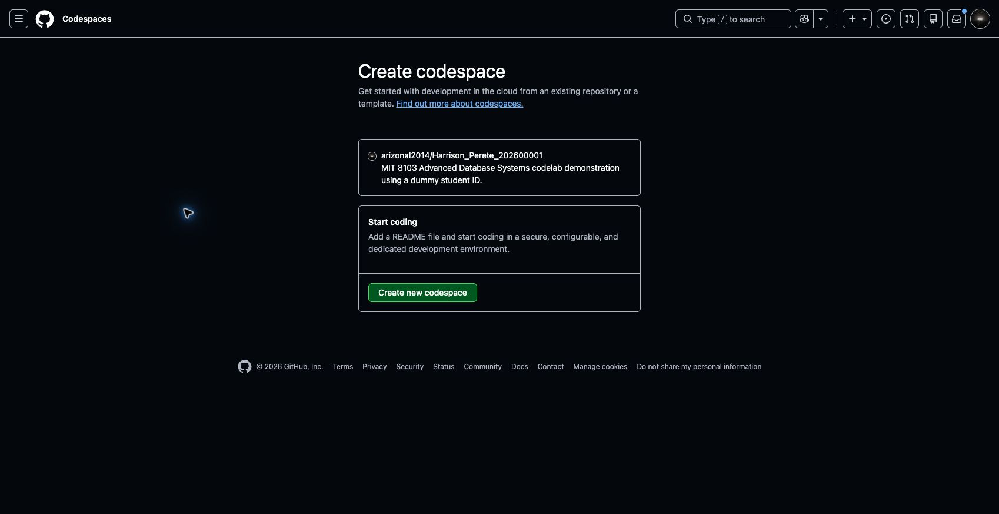
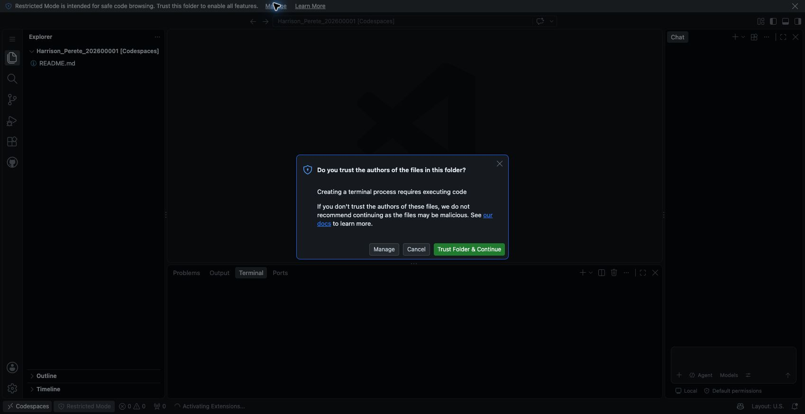
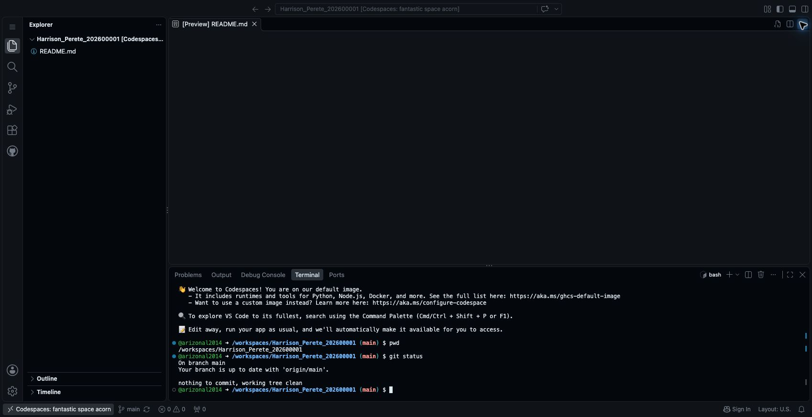

# Step 2 Open your workspace in GitHub Codespaces

Codespaces gives you a browser-based editor and terminal. We will use it to create files, run database commands and save changes to GitHub.

This supports Section 5 of the assessment brief: keeping your implementation and evidence in a repository as the work develops.

## Open Codespaces

1. On the empty repository page from Step 1, click **Create a codespace** under **Start coding with Codespaces**.
2. Check that the next page shows your account and repository name.
3. Click **Create new codespace**.



4. Wait for setup and the remote connection to finish. The first start can take a few minutes.
5. If asked **Do you trust the authors of the files in this folder?**, check that this is the repository you just created, then click **Trust Folder & Continue**. This enables the terminal for your workspace.



**What you should see:** the VS Code editor in your browser, with your repository in the Explorer on the left and a Terminal panel below the editor. In our demonstration, GitHub automatically added an initial `README.md` when opening the empty repository through this route. We will update its name and contents in the next step.

## Find your way around

- **Explorer:** create and open your project files.
- **Editor:** write SQL, notes and other files.
- **Terminal:** enter commands and read their output.
- **Source Control:** review and save changes to GitHub.
- **Chat:** use GitHub Copilot if it is available on your account.

You can close the Chat panel to give the editor more space. The codelab instructions do not require Copilot.

## Check your workspace

Click inside the terminal. If it is not visible, open the application menu in the upper-left corner and choose **Terminal → New Terminal**.

Run the following commands separately:

```bash
pwd
```

The path should end with your repository name, for example `/workspaces/Harrison_Perete_202600001`.

```bash
git status
```

This shows your branch and whether any files have changed.

In the demonstration, the result showed branch `main`, up to date with `origin/main`, and `nothing to commit, working tree clean`.



Your workspace is ready when the terminal path ends with your repository name and `git status` runs successfully.

Keep the workspace open for the next step. When you finish a practice session, visit [Your Codespaces](https://github.com/codespaces) and use the workspace's three-dot menu to stop it. Codespaces has account usage limits; [check your allowance](https://docs.github.com/en/billing/concepts/product-billing/github-codespaces) if GitHub prevents creation.

**Next: [Step 3 — Create your portfolio folders and first commit](03_Create_Portfolio_Structure.md).**

[Back to Step 1](01_Create_Your_Repository.md)
