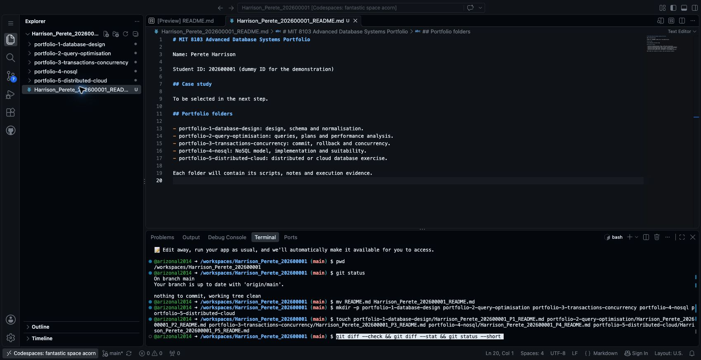
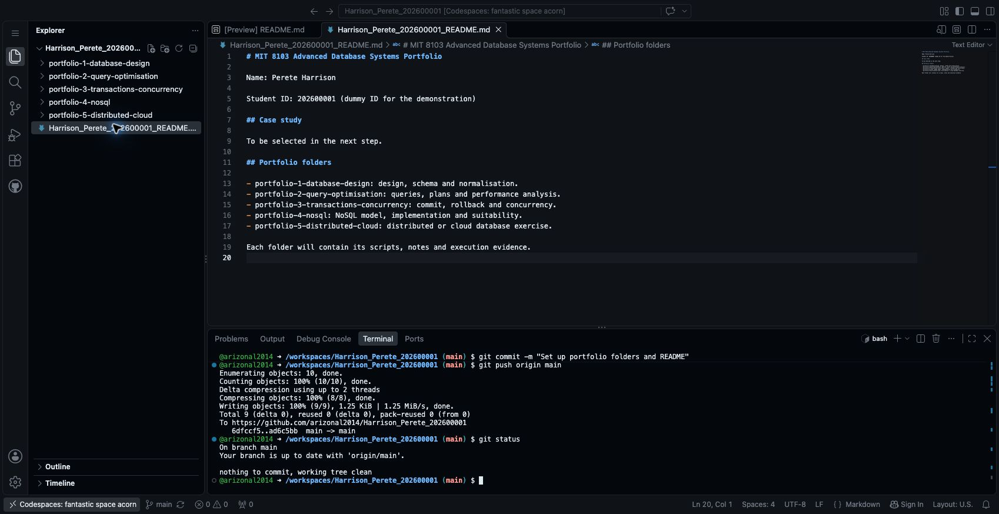
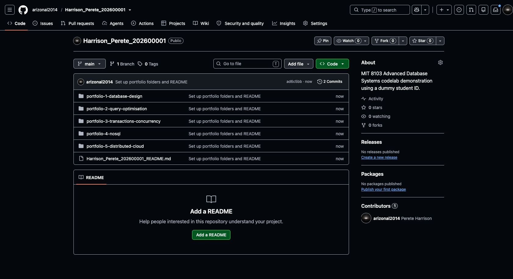

# Step 3 Create your portfolio folders and first commit

Section 5 of the [assessment brief](https://lms-assets.miva.university/course-materials/mit-8103-advanced-database-systems-ca-september-cohort-2026.pdf) suggests separate folders for the five portfolios and asks for progressive GitHub commits. We will create that structure now.

**Use your own name and student ID wherever you see `Harrison_Perete_202600001`.** Run the terminal commands from your repository folder in Codespaces.

## Rename your README

The previous step created `README.md` automatically. Rename it to follow the submission filename convention:

```bash
mv README.md Harrison_Perete_202600001_README.md
```

If your file is already correctly named, skip this command.

## Add your details

Double-click the renamed file in Explorer. Replace its contents with the following, using your own details:

```markdown
# MIT 8103 Advanced Database Systems Portfolio

Name: Perete Harrison

Student ID: 202600001 (dummy ID for the demonstration)

## Case study

To be selected in the next step.

## Portfolio folders

- portfolio-1-database-design: design, schema and normalisation.
- portfolio-2-query-optimisation: queries, plans and performance analysis.
- portfolio-3-transactions-concurrency: commit, rollback and concurrency.
- portfolio-4-nosql: NoSQL model, implementation and suitability.
- portfolio-5-distributed-cloud: distributed or cloud database exercise.

Each folder will contain its scripts, notes and execution evidence.
```

Save with **Ctrl+S** on Windows/Linux or **Cmd+S** on macOS. If the file opens as a rendered preview, choose **Open Source File** to edit its text.

## Create the five folders

In the terminal, run each line:

```bash
mkdir -p portfolio-1-database-design
mkdir -p portfolio-2-query-optimisation
mkdir -p portfolio-3-transactions-concurrency
mkdir -p portfolio-4-nosql
mkdir -p portfolio-5-distributed-cloud
```

`mkdir` creates a directory. The `-p` option allows the command to succeed if the directory already exists.

Git does not store empty directories. Add an empty README to each folder so it can be saved to GitHub. We will fill these files during their respective activities.

```bash
touch portfolio-1-database-design/Harrison_Perete_202600001_P1_README.md
touch portfolio-2-query-optimisation/Harrison_Perete_202600001_P2_README.md
touch portfolio-3-transactions-concurrency/Harrison_Perete_202600001_P3_README.md
touch portfolio-4-nosql/Harrison_Perete_202600001_P4_README.md
touch portfolio-5-distributed-cloud/Harrison_Perete_202600001_P5_README.md
```

`touch` creates an empty file if it does not already exist. Expand the folders in Explorer to see the files.



## Save your changes to GitHub

Run each command separately.

Check what changed:

```bash
git status
```

Prepare the changes for the next saved version:

```bash
git add -A
```

Review the files you are about to save:

```bash
git diff --cached --stat
```

You should see your personalised README, five portfolio README files and the removal of the old `README.md`. Git may recognise the README change as a rename instead.

Create a commit, which records this version of your work:

```bash
git commit -m "Set up portfolio folders and README"
```

Send the commit to GitHub:

```bash
git push origin main
```

Check again:

```bash
git status
```

**Expected result:** `Your branch is up to date with 'origin/main'` and `nothing to commit, working tree clean`.



## Confirm on GitHub

Open your repository on GitHub in another browser tab. Refresh it if necessary. Check that the five folders, personalised README and commit message are visible.



GitHub may still display **Add a README** because the personalised filename is not its standard `README.md`. Your file is present in the file list; click its name to read it.

**Next: [Step 4 — Choose and describe your case study](04_Choose_Your_Case_Study.md).**

[Back to Step 2](02_Open_Codespaces.md)
