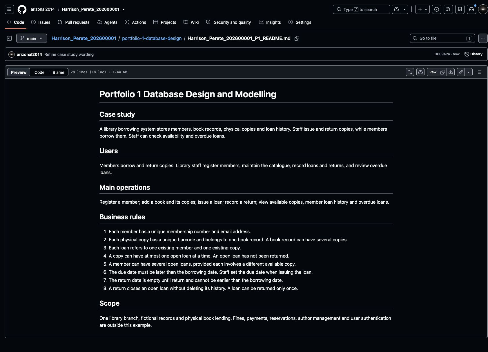

# Step 4 Choose and describe your case study

Section 2 of the [assessment brief](https://lms-assets.miva.university/course-materials/mit-8103-advanced-database-systems-ca-september-cohort-2026.pdf) asks you to choose a realistic system and use it throughout the portfolio. Section 4 requires a case-study description for Portfolio 1.

## Choose a system

Choose a system you understand: a library, clinic, hotel, online shop, university results portal or another suitable organisation. You will use the same system for all five activities.

Our demonstration uses a **library borrowing system**. You can follow the method with a different case study.

## Describe what it does

Open your Portfolio 1 README in Explorer. Complete these headings using your own case study:

```markdown
# Portfolio 1 Database Design and Modelling

## Case study
[Name of your system and a short explanation of what it does.]

## Users
[Who uses the system and what each user does.]

## Main operations
[List the operations your database needs to support.]

## Business rules
[Number the rules that define valid data and operations.]

## Scope
[State what you include and what you leave out.]
```

A business rule is a condition your system must follow. For example, one physical library copy cannot have two open loans at the same time. An open loan is a loan that has not been returned.

## Demonstration example

**Case study:** A library borrowing system stores members, book records, physical copies and loan history. Staff issue and return copies, while members borrow them. Staff can check availability and overdue loans.

**Users:** Members borrow and return copies. Library staff register members, maintain the catalogue, record loans and returns, and review overdue loans.

**Main operations:** Register a member; add a book and its copies; issue a loan; record a return; view available copies, member loan history and overdue loans.

**Business rules:**

1. Each member has a unique membership number and email address.
2. Each physical copy has a unique barcode and belongs to one book record. A book record can have several copies.
3. Each loan refers to one existing member and one existing copy.
4. A copy can have at most one open loan at a time.
5. A member can have several open loans, provided each involves a different available copy.
6. The due date must be later than the borrowing date. Staff set the due date when issuing the loan.
7. The return date is empty until return and cannot be earlier than the borrowing date.
8. A return closes an open loan without deleting its history. A loan can be returned only once.

**Scope:** One library branch, fictional records and physical book lending. Fines, payments, reservations, author management and user authentication are outside this example.

These rules are choices for this example, not additional assessment requirements. Choose rules that fit your own system.

## Prompt

Enter your case-study name and paste the demonstration example where indicated. The AI will propose the users, operations, rules and scope for you to review. You do not need to work these out before using the prompt.

```text
I am completing the case-study description for MIT 8103 Portfolio 1.
Use the worked library example below as a reference for structure,
length and level of detail.

REFERENCE EXAMPLE
[PASTE THE LIBRARY EXAMPLE FROM CASE STUDY THROUGH SCOPE HERE]

MY CHOSEN CASE STUDY
[ENTER YOUR SYSTEM, FOR EXAMPLE HOTEL RESERVATION SYSTEM]

Produce a case-study description for MY chosen system using exactly
these headings, in this order:

# Portfolio 1 Database Design and Modelling
## Case study
## Users
## Main operations
## Business rules
## Scope

Follow these limits:
- Maximum 300 words for the description, excluding any assumption note.
- Case study: one short paragraph of no more than three sentences.
- Users: one short paragraph identifying the main roles and their tasks.
- Main operations: one paragraph listing five to seven relevant actions.
- Business rules: exactly eight numbered rules, each no more than two
  short sentences. Include identifiers, relationships, valid values or
  dates, and a rule that prevents a conflicting operation where relevant.
- Scope: one short paragraph stating what is included and excluded.
- Propose a small, practical scope suitable for this database assessment.
  State what it includes and excludes. Use fictional data.

Use my case-study name to propose suitable users, operations, eight
business rules and scope. Produce a complete first draft without asking
me to supply those details first. Incorporate any additional requirements
I provide and briefly flag conflicts.
Adapt the actual operations and rules to my system. Do not simply rename
library terms or paraphrase its sentences.
After the description, add one brief "Assumptions to confirm" note naming
the main scope choices and proposed rules I should review.

Write directly about the system in a style suitable for my individual
assessment. Avoid instructor commentary or collective statements about
what a class will or will not build. State scope neutrally.

Return only the description and the assumption note.
Do not add tables, attributes, SQL, an ER diagram, normalisation,
implementation results, introductions or later portfolio activities.
```

Review the proposed users, operations, eight rules and scope. Keep what fits your system and change anything you do not intend to implement. If a rule is unclear, ask the AI to explain it with a simple example. Save the agreed description under the five headings in your Portfolio 1 README and update the Case study paragraph in your root README to match. The assumption note is a review aid. The length and eight-rule limits are tutorial choices, not assessment requirements.

## Save your progress

Run each line separately in the terminal:

```bash
git diff
git add Harrison_Perete_202600001_README.md portfolio-1-database-design/Harrison_Perete_202600001_P1_README.md
git commit -m "Describe case study and business rules"
git push origin main
git status
```

Replace the demonstration filenames with yours. If `git diff` opens a scrolling view, press **q** to leave it before entering the next command.

**Check:** You can explain your users, operations and every business rule. The two README files describe the same system, and Git reports a clean working tree up to date with `origin/main`.

Open your Portfolio 1 README on GitHub to confirm it was pushed. The demonstration looks like this:



This completes the case-study description part of Portfolio 1. The ER diagram, schema, keys, constraints and normalisation still follow.

**Next: [Step 5 — Identify entities, attributes, keys and relationships](05_Entities_Keys_Relationships.md).**

[Back to Step 3](03_Create_Portfolio_Structure.md)
