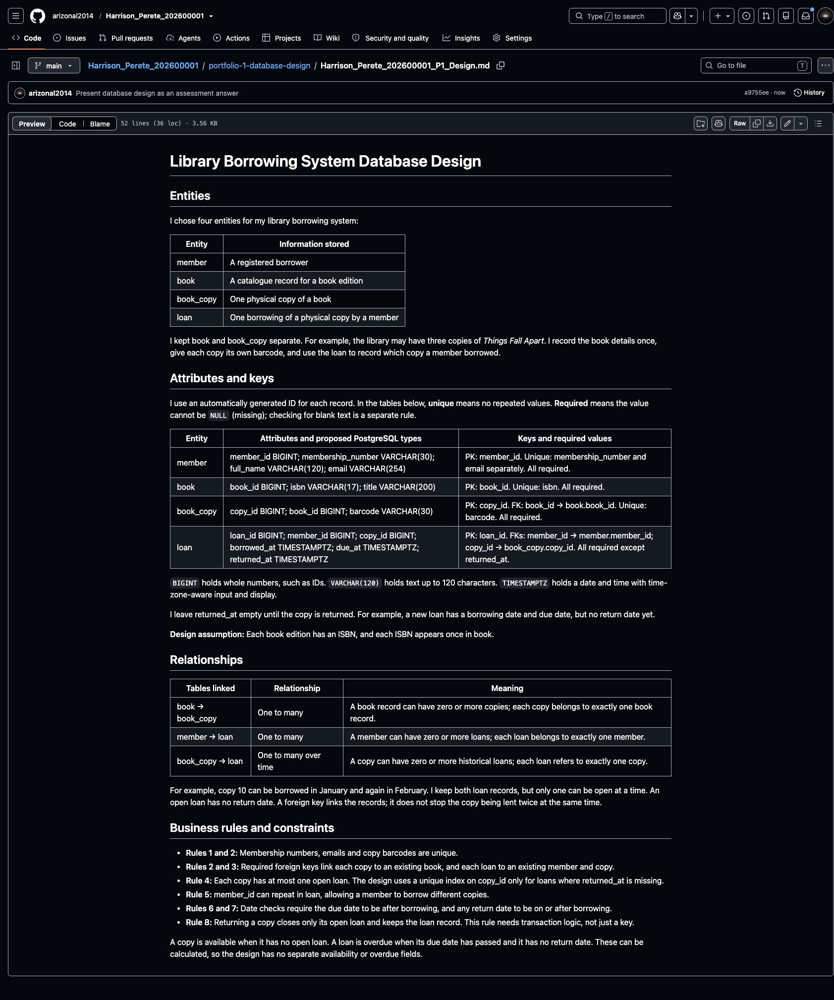

# Step 5 Identify entities, attributes, keys and relationships

Section 4 of the [assessment brief](https://lms-assets.miva.university/course-materials/mit-8103-advanced-database-systems-ca-september-cohort-2026.pdf) requires an ER diagram, relational schema, keys and constraints for Portfolio 1. This step records the design decisions needed for those deliverables.

## Identify your entities

Read your case study from Step 4. Here are the main terms:

- **Entity:** something the database keeps records of. Example: a library member.
- **Attribute:** a detail about it. Example: the member's name or email.
- **Primary key (PK):** the ID for one record. Example: member_id 1 identifies one member.
- **Foreign key (FK):** an ID linking two tables. Example: member_id 1 in a loan tells me who borrowed the book.
- **Relationship:** how records connect. Example: one member can have several loans.

Save the following example, including its title, in the design file.

### Library Borrowing System Database Design

#### Entities

I chose four entities for my library borrowing system:

| Entity | Information stored |
| --- | --- |
| member | A registered borrower |
| book | A catalogue record for a book edition |
| book_copy | One physical copy of a book |
| loan | One borrowing of a physical copy by a member |

I kept book and book_copy separate. For example, the library may have three copies of *Things Fall Apart*. I record the book details once, give each copy its own barcode, and use the loan to record which copy a member borrowed.

#### Attributes and keys

I use an automatically generated ID for each record. In the tables below, **unique** means no repeated values. **Required** means the value cannot be `NULL` (missing); checking for blank text is a separate rule.

| Entity | Attributes and proposed PostgreSQL types | Keys and required values |
| --- | --- | --- |
| member | member_id BIGINT; membership_number VARCHAR(30); full_name VARCHAR(120); email VARCHAR(254) | PK: member_id. Unique: membership_number and email separately. All required. |
| book | book_id BIGINT; isbn VARCHAR(17); title VARCHAR(200) | PK: book_id. Unique: isbn. All required. |
| book_copy | copy_id BIGINT; book_id BIGINT; barcode VARCHAR(30) | PK: copy_id. FK: book_id → book.book_id. Unique: barcode. All required. |
| loan | loan_id BIGINT; member_id BIGINT; copy_id BIGINT; borrowed_at TIMESTAMPTZ; due_at TIMESTAMPTZ; returned_at TIMESTAMPTZ | PK: loan_id. FKs: member_id → member.member_id; copy_id → book_copy.copy_id. All required except returned_at. |

`BIGINT` holds whole numbers, such as IDs. `VARCHAR(120)` holds text up to 120 characters. `TIMESTAMPTZ` holds a date and time with time-zone-aware input and display.

I leave returned_at empty until the copy is returned. For example, a new loan has a borrowing date and due date, but no return date yet.

**Design assumption:** Each book edition has an ISBN, and each ISBN appears once in book.

#### Relationships

| Tables linked | Relationship | Meaning |
| --- | --- | --- |
| book → book_copy | One to many | A book record can have zero or more copies; each copy belongs to exactly one book record. |
| member → loan | One to many | A member can have zero or more loans; each loan belongs to exactly one member. |
| book_copy → loan | One to many over time | A copy can have zero or more historical loans; each loan refers to exactly one copy. |

For example, copy 10 can be borrowed in January and again in February. I keep both loan records, but only one can be open at a time. An open loan has no return date. A foreign key links the records; it does not stop the copy being lent twice at the same time.

#### Business rules and constraints

- **Rules 1 and 2:** Membership numbers, emails and copy barcodes are unique.
- **Rules 2 and 3:** Required foreign keys link each copy to an existing book, and each loan to an existing member and copy.
- **Rule 4:** Each copy has at most one open loan. The design uses a unique index on copy_id only for loans where returned_at is missing.
- **Rule 5:** member_id can repeat in loan, allowing a member to borrow different copies.
- **Rules 6 and 7:** Date checks require the due date to be after borrowing, and any return date to be on or after borrowing.
- **Rule 8:** Returning a copy closes only its open loan and keeps the loan record. This rule needs transaction logic, not just a key.

A copy is available when it has no open loan. A loan is overdue when its due date has passed and it has no return date. These can be calculated, so the design has no separate availability or overdue fields.

## Adapt the design to your case study

Copy the worked example, including **Library Borrowing System Database Design**, into the prompt below. Add your own case study from Step 4.

```text
I am completing MIT 8103 Portfolio 1: Database Design and Modelling.

MY AGREED CASE STUDY AND NUMBERED BUSINESS RULES
[PASTE THE DESCRIPTION SAVED IN STEP 4]

REFERENCE DESIGN
[PASTE THE LIBRARY DESIGN FROM STEP 5]

Create a short assessment design for MY case study, following the example.
Start with the title: "[MY CASE STUDY NAME] Database Design".
Then use these headings:
1. Entities — what the database keeps records of.
2. Attributes and keys — fields, PostgreSQL types, PKs, FKs,
   unique fields, and which values are required or optional.
3. Relationships — how the tables connect. Explain both directions,
   including whether zero records are allowed. Add a linking table if needed.
4. Business rules and constraints — match every numbered rule to a database
   check or operation. Explain any rule a key alone cannot enforce.
5. Design assumptions — up to three points, only if needed.

Use the smallest design that supports my agreed operations. Aim for four
to six entities, but explain if a different number is necessary. This is
a tutorial size guide, not an assessment rule. Propose the details yourself.
Keep my existing scope and rules. Flag any necessary change explicitly.
Do not rename library entities mechanically to fit a different domain.
Avoid storing values that can be calculated unless you justify the choice.
Present the design as an assessment answer, not a plan or instructions.
Use present tense: "Each copy has a unique barcode", not "I will...".
Use "I chose" only when briefly explaining a personal design decision.
Use basic words and one small example. Explain any technical term needed.
Do not claim the database has been created or tested.
Keep the response under 650 words. Return only the title and sections above.
Do not generate SQL, a diagram, normalisation or execution results yet.
```

## Save the design

1. In Explorer, right-click your `portfolio-1-database-design` folder and choose **New File**.
2. Name it `Harrison_Perete_202600001_P1_Design.md`, replacing the name and ID with yours.
3. Save the title and your reviewed design in that file. For the library example, start with `# Library Borrowing System Database Design`, then copy the sections above.
4. Read your design alongside the business rules from Step 4. Check that each rule is covered. For example, every loan needs a member and a book copy, and the same copy cannot have two open loans. This is a reading check; no database commands are needed yet.
5. Run each command separately in the terminal, using your own filename:

```bash
git diff --check
git add portfolio-1-database-design/Harrison_Perete_202600001_P1_Design.md
git commit -m "Define entities keys and relationships"
git push origin main
git status
```

**Check:** Open the saved design on GitHub. Explain why each entity exists and how its keys link it to the others. This is the proposed design; database enforcement will be verified during implementation.



**Next: [Step 6 — Create the ER diagram](06_Create_ER_Diagram.md).**

[Back to Step 4](04_Choose_Your_Case_Study.md)
