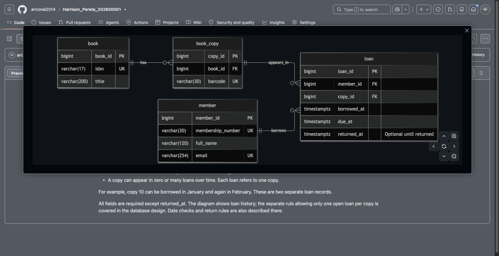

# Step 6 Create the ER diagram

Portfolio 1 in Section 4 of the [assessment brief](https://lms-assets.miva.university/course-materials/mit-8103-advanced-database-systems-ca-september-cohort-2026.pdf) requires an **ER diagram**: a picture of the tables and their relationships.

Mermaid turns text into a diagram on GitHub. No download or upload is needed. [GitHub's diagram guide](https://docs.github.com/en/get-started/writing-on-github/working-with-advanced-formatting/creating-diagrams).

## 1. Prepare the diagram

See the [completed library ER diagram](https://github.com/arizonal2014/Harrison_Perete_202600001/blob/main/portfolio-1-database-design/Harrison_Perete_202600001_P1_ERDiagram.md) for an example of the result. Its four boxes show the tables, and the lines show how they connect.

Use the prompt below with your design from Step 5. Save the response using the filename in Step 2, replacing the name and ID with yours.

```text
I am completing MIT 8103 Portfolio 1. Turn my agreed database design
below into one Markdown file containing a Mermaid ER diagram.

MY DATABASE DESIGN
[PASTE YOUR DESIGN FROM STEP 5]

Start with the title: "[MY CASE STUDY NAME] ER Diagram".
Include one fenced mermaid block starting with erDiagram.
Use direction LR so the diagram runs left to right.
Use exactly the tables, fields, types and relationships in my design.
Mark primary keys PK, foreign keys FK and unique fields UK.
Show whether each relationship means exactly one, zero or one,
or zero or many. Do not add or change any business rules.
After the diagram, explain PK, FK, UK and the relationship symbols
in simple words. Include one small example from my case study.
State which fields are optional and briefly note any rules that
need additional constraints or transaction logic.
Write this as a short assessment answer in present tense, not a plan.
Return only the Markdown file contents, without an outer code fence.
Do not generate SQL or claim anything has been executed.
```

## 2. Save it in Codespaces

1. Right-click `portfolio-1-database-design` in Explorer and choose **New File**.
2. Name it `Harrison_Perete_202600001_P1_ERDiagram.md`. Replace the name and ID with yours.
3. Paste the complete Markdown and save it. Seeing diagram text in the editor is normal.

## 3. Send it to GitHub

Run each command separately, using your own filename:

```bash
git diff --check
git add portfolio-1-database-design/Harrison_Perete_202600001_P1_ERDiagram.md
git commit -m "Add ER diagram"
git push origin main
```

## 4. View and check it

Open your repository on GitHub, open the Portfolio 1 folder, then open the ERDiagram.md file. Choose **Preview** if it displays code.

For the library example, check that four boxes appear: member, book, book_copy and loan. The lines should match the relationships from Step 5. For example, one member can have several loans, but each loan belongs to one member.



If GitHub reports a diagram error, copy the error and diagram text into your AI assistant and ask it to fix the syntax without changing the design. Save, commit and push the correction.

**Using only GitHub's website?** Open the Portfolio 1 folder, choose **Add file → Create new file**, enter the filename, paste the contents and choose **Commit changes**. Codespaces users then run `git pull --ff-only` before continuing there.

**Next: [Step 7 — Explain normalisation](07_Normalisation.md).**

[Back to Step 5](05_Entities_Keys_Relationships.md)
