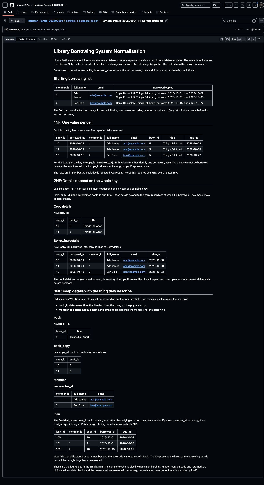

# Step 7 Explain normalisation

Portfolio 1 in Section 4 of the [assessment brief](https://lms-assets.miva.university/course-materials/mit-8103-advanced-database-systems-ca-september-cohort-2026.pdf) requires a **normalisation explanation**. Show the changes using tables, not definitions alone.

Normalisation reduces repeated information. For example, a member's email belongs in the member table, rather than being copied into every loan.

## 1. Follow the library example

Read the [worked library example](Library_Normalisation_Example.md). It follows the same records through:

1. **1NF:** One borrowing per row, with one value per cell.
2. **2NF:** Move copy details away from the combined borrowing key.
3. **3NF:** Put book details in book and member details in member.

The result matches the four tables in the ER diagram. These are example records explaining the design, not database execution results.

See the [completed library answer on GitHub](https://github.com/arizonal2014/Harrison_Perete_202600001/blob/main/portfolio-1-database-design/Harrison_Perete_202600001_P1_Normalisation.md).

## 2. Adapt it to your case study

Use this prompt with your Step 5 design and the worked library example:

```text
I am completing MIT 8103 Portfolio 1. Explain normalisation for my case
study using small example tables, following the reference's simple style.

MY AGREED DATABASE DESIGN AND BUSINESS RULES
[PASTE YOUR DESIGN FROM STEP 5]

REFERENCE EXAMPLE
[PASTE THE WORKED LIBRARY NORMALISATION EXAMPLE]

Start with the title: "[MY CASE STUDY NAME] Normalisation".
Show a starting record with a repeated list, then 1NF, 2NF and 3NF.
Use the same two or three fictional example records throughout.
At every stage, show actual tables, name the keys, and briefly explain
what moved, why it moved, and which repeated detail or update problem
is removed. Define any technical term in basic words.
For 2NF, identify fields depending on only part of a combined key.
If there is no such dependency, explain why it is already in 2NF;
do not invent one. State any assumptions needed for example keys.
For 3NF, show fields depending on another non-key field and separate
them where needed. Explain how IDs keep the resulting tables linked.
The final tables must match my agreed design. You may show selected
fields for readability, but list any fields left out of the examples.
Explain separately if the final design replaces an example combined
key with an automatically generated ID. An ID alone does not prove 3NF.
Use present tense, not "I will". Return only the Markdown answer.
Do not generate SQL or claim these example records were executed.
```

## 3. Save and commit

1. Create `Harrison_Perete_202600001_P1_Normalisation.md` inside `portfolio-1-database-design`. Replace the name and ID with yours.
2. Paste your reviewed answer, including its title. For the library demo, use the worked example.
3. Check that the same records appear at every stage and the final tables match your ER diagram.
4. Run these commands separately, using your own filename:

```bash
git diff --check
git add portfolio-1-database-design/Harrison_Perete_202600001_P1_Normalisation.md
git commit -m "Explain normalisation with example tables"
git push origin main
```

Open the file on GitHub and check that the tables display correctly.



**Next: [Step 8 — Set up PostgreSQL](08_Set_Up_PostgreSQL.md).**

[Back to Step 6](06_Create_ER_Diagram.md)
