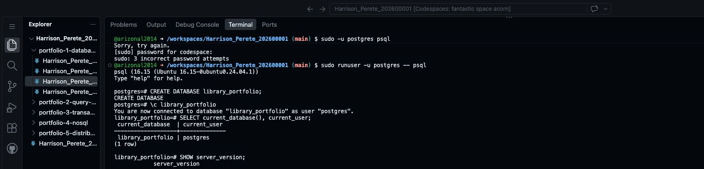

# Step 8 Set up PostgreSQL

Portfolio 1 in Section 4 of the [assessment brief](https://lms-assets.miva.university/course-materials/mit-8103-advanced-database-systems-ca-september-cohort-2026.pdf) requires tables, keys and constraints. This step sets up PostgreSQL and creates an empty database to hold your tables.

Run these commands in the **Codespaces terminal**, not your computer's terminal.

In Codespaces, open **Terminal → New Terminal** from the main menu if you cannot see the terminal panel. Click inside the terminal before typing.

Copy one command, press **Enter**, then wait for it to finish. Do not copy the surrounding backticks or type the prompt symbols such as `$` or `postgres=#`.

Already using PostgreSQL elsewhere? Connect to a new practice database there and continue to the table-creation step. The Ubuntu setup commands below are only for Codespaces.

## 1. Install PostgreSQL

The terminal initially shows a line ending in `$`. This is where the installation commands go. After each command finishes, a new `$` line appears, ready for the next command.

```bash
sudo apt-get update
```

This refreshes the list of available software. Wait for it to finish.

```bash
sudo apt-get install -y postgresql
```

This installs PostgreSQL. It may take a few minutes. [PostgreSQL's Ubuntu installation guide](https://www.postgresql.org/download/linux/ubuntu/).

If installation says `policy-rc.d denied execution of start`, continue to Step 2. Codespaces can block automatic startup during installation; the next command starts PostgreSQL explicitly.

## 2. Start the database server

PostgreSQL must be running before you can use it. Enter:

```bash
sudo service postgresql start
```

## 3. Open PostgreSQL

```bash
sudo runuser -u postgres -- psql
```

If you see `postgres=#`, PostgreSQL is running and the connection worked. This is where you type SQL commands, such as `CREATE DATABASE`.

The command opens PostgreSQL using its local administrator account, called `postgres`. This connection does not need a database password. It is for this practice workspace.

## 4. Create your practice database

A database is a named space that holds your tables. The library example uses `library_portfolio`.

**For your own case study, ask your AI:**

```text
My MIT 8103 case study is: [INSERT YOUR CASE STUDY NAME].
Choose one short PostgreSQL database name for it.
Use only lowercase letters and underscores, ending in _portfolio.
Start with a letter. Do not include spaces, my name or my student ID.
Return the name, followed by these two commands using that exact name:
1. CREATE DATABASE the_name;
2. \c the_name
Do not add other commands or sample output.
```

For example, a clinic case study could use `clinic_portfolio`. Keep your chosen name for the later steps.

At `postgres=#`, enter the first command from the AI response. For the library example, it is:

```sql
CREATE DATABASE library_portfolio;
```

Keep the semicolon at the end. PostgreSQL uses it to know the SQL command is complete.

Expected result: `CREATE DATABASE`. If it says the database already exists, do not create it again; continue with the connection command below.

Now enter the second command, replacing the name if yours is different:

```text
\c library_portfolio
```

`\c` means connect to that database. The prompt changes to `library_portfolio=#`, or your chosen name followed by `=#`.

Check the connection:

```sql
SELECT current_database(), current_user;
```

The result should show your chosen database name and the user `postgres`.

Here is the result for the library example. Your database name may be different.



Keep this PostgreSQL session open. The next step creates your tables here.

## 5. Save evidence

Take a screenshot of the connection-check query and its result. It should show your database name and the user `postgres`. Begin the screenshot filename with your required name and student ID, for example `Harrison_Perete_202600001_P1_DatabaseConnection.png`.

In Codespaces Explorer, right-click `portfolio-1-database-design` → **New Folder…** and name it `screenshots`. Right-click that new folder → **Upload…** and select your picture. Keep the SQL and design files in the parent Portfolio 1 folder.

Keep the same Codespace for the practical work. GitHub saves your project files, not the running database. Rebuilding or deleting the Codespace can remove the installed server or database; save scripts and back up data first.

When returning after the Codespace has stopped, use these commands at the terminal's `$` prompt:

```bash
sudo service postgresql start
sudo runuser -u postgres -- psql
```

Then enter `\c library_portfolio` inside PostgreSQL, using your own database name. There is no need to repeat `CREATE DATABASE`.

**Next: [Step 9 — Create and check the tables](09_Create_And_Check_Tables.md).**

[Back to Step 7](07_Normalisation.md)
