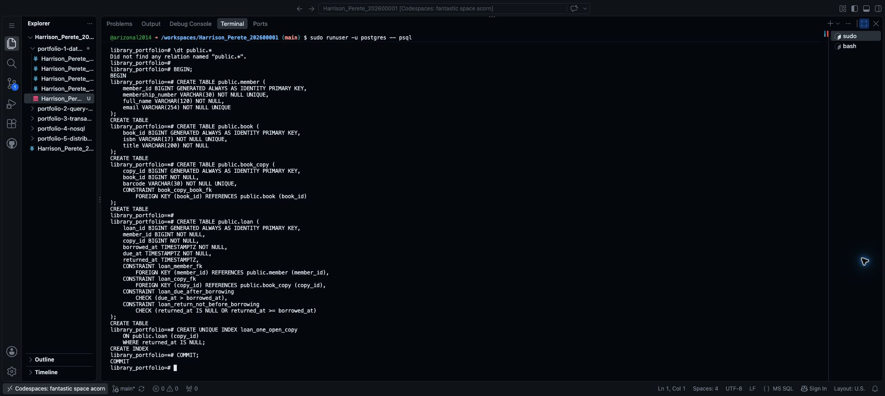
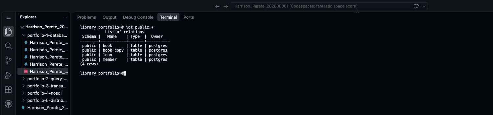
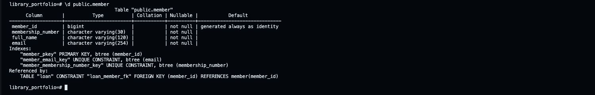
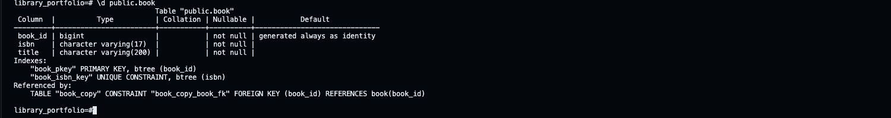
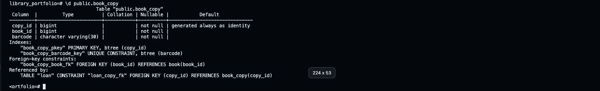
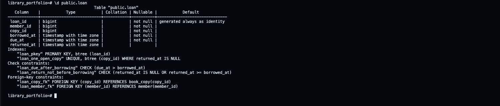

# Step 9 Create and check the tables

Portfolio 1 in Section 4 of the [assessment brief](https://lms-assets.miva.university/course-materials/mit-8103-advanced-database-systems-ca-september-cohort-2026.pdf) requires a **relational schema, keys and constraints**. Here, the design becomes actual PostgreSQL tables.

## 1. Prepare your SQL file

The library example uses [this SQL file](Harrison_Perete_202600001_P1_Schema.sql). SQL is the text PostgreSQL reads to create the tables.

For your own case study, use this prompt:

```text
I am completing MIT 8103 Portfolio 1. Write a PostgreSQL 16 schema
from my agreed design below.

MY DESIGN AND NUMBERED BUSINESS RULES
[PASTE YOUR DESIGN FROM STEP 5]

Return only SQL file contents, with short, simple comments.
Keep exactly my agreed tables, fields, types and relationships.
Create the tables in public, with referenced tables created first.
Use automatically generated identity IDs and primary keys as designed.
Include required NOT NULL fields, UNIQUE rules, foreign keys and CHECKs.
Keep optional fields nullable. Use a partial unique index if a rule
requires uniqueness only for some rows, such as open loans.
Wrap the statements in BEGIN and COMMIT. Do not insert sample data.
Do not use DROP, IF NOT EXISTS, passwords or database-creation commands.
Do not claim that rules needing later transaction logic are enforced
by the table definitions; mention those limits in a short SQL comment.
```

In Codespaces, create a file in `portfolio-1-database-design` named `Harrison_Perete_202600001_P1_Schema.sql`, using your own name and ID. Paste the reviewed SQL and save it.

The `.sql` file stores the commands. Saving it does not create tables; running its commands does.

Pictures go in `portfolio-1-database-design/screenshots`. If that folder does not exist yet, right-click `portfolio-1-database-design` in Explorer → **New Folder…** → enter `screenshots`. Keep your SQL files in the parent folder.

In every filename below, replace `Harrison_Perete_202600001` with your own **Surname_Firstname_StudentID**. For another case study, use your own table names instead of Member, Book or Loan. Use no spaces. Keep the picture's actual extension: `.png` or `.jpg`.

On a phone or tablet, use its screenshot buttons. If you need to rename a picture after uploading, right-click it in Codespaces Explorer and choose **Rename…**.

## 2. Check where you are

Use the PostgreSQL session from Step 8. The prompt should show your database name, such as `library_portfolio=#`.

```sql
SELECT current_database();
```

For this demo, the result must be `library_portfolio`. Then enter:

```text
\dt public.*
```

Before the first run, the practice database should have no tables. If it already contains tables, stop and check them; do not delete them or run the schema again blindly.

## 3. Create the tables, one at a time

The complete library commands are below, in order. Run each block once in PostgreSQL. For a different case study, use the matching commands from your own SQL file.

If a command fails, enter `ROLLBACK;`, fix your SQL, then restart this group. Do not continue after an error.

### Start the group

```sql
BEGIN;
```

Expected result: `BEGIN`.

### Create member

Copy this whole block and press **Enter**:

```sql
CREATE TABLE public.member (
    member_id BIGINT GENERATED ALWAYS AS IDENTITY PRIMARY KEY,
    membership_number VARCHAR(30) NOT NULL UNIQUE,
    full_name VARCHAR(120) NOT NULL,
    email VARCHAR(254) NOT NULL UNIQUE
);
```

Expected result: `CREATE TABLE`.

Take a screenshot of the command and result: **Mac:** Shift + Command + 4; **Windows:** Windows + Shift + S. Save it as `Harrison_Perete_202600001_P1_MemberCreation.png`. In Codespaces Explorer, right-click its `screenshots` folder → **Upload…** → select the picture. Check that it appears in the folder.

### Create book

```sql
CREATE TABLE public.book (
    book_id BIGINT GENERATED ALWAYS AS IDENTITY PRIMARY KEY,
    isbn VARCHAR(17) NOT NULL UNIQUE,
    title VARCHAR(200) NOT NULL
);
```

Expected result: `CREATE TABLE`.

Take a screenshot of the command and result: **Mac:** Shift + Command + 4; **Windows:** Windows + Shift + S. Save it as `Harrison_Perete_202600001_P1_BookCreation.png`. In Codespaces Explorer, right-click its `screenshots` folder → **Upload…** → select the picture.

### Create book_copy

```sql
CREATE TABLE public.book_copy (
    copy_id BIGINT GENERATED ALWAYS AS IDENTITY PRIMARY KEY,
    book_id BIGINT NOT NULL,
    barcode VARCHAR(30) NOT NULL UNIQUE,
    CONSTRAINT book_copy_book_fk
        FOREIGN KEY (book_id) REFERENCES public.book (book_id)
);
```

Expected result: `CREATE TABLE`.

Take a screenshot of the command and result: **Mac:** Shift + Command + 4; **Windows:** Windows + Shift + S. Save it as `Harrison_Perete_202600001_P1_BookCopyCreation.png`. In Codespaces Explorer, right-click its `screenshots` folder → **Upload…** → select the picture.

### Create loan

```sql
CREATE TABLE public.loan (
    loan_id BIGINT GENERATED ALWAYS AS IDENTITY PRIMARY KEY,
    member_id BIGINT NOT NULL,
    copy_id BIGINT NOT NULL,
    borrowed_at TIMESTAMPTZ NOT NULL,
    due_at TIMESTAMPTZ NOT NULL,
    returned_at TIMESTAMPTZ,
    CONSTRAINT loan_member_fk
        FOREIGN KEY (member_id) REFERENCES public.member (member_id),
    CONSTRAINT loan_copy_fk
        FOREIGN KEY (copy_id) REFERENCES public.book_copy (copy_id),
    CONSTRAINT loan_due_after_borrowing
        CHECK (due_at > borrowed_at),
    CONSTRAINT loan_return_not_before_borrowing
        CHECK (returned_at IS NULL OR returned_at >= borrowed_at)
);
```

Expected result: `CREATE TABLE`.

Take a screenshot of the command and result: **Mac:** Shift + Command + 4; **Windows:** Windows + Shift + S. Save it as `Harrison_Perete_202600001_P1_LoanCreation.png`. In Codespaces Explorer, right-click its `screenshots` folder → **Upload…** → select the picture.

`NOT NULL` means a value is required. `UNIQUE` prevents repeats. `REFERENCES` links tables. `CHECK` checks a rule, such as the due date being after borrowing. `public` is the standard area where these tables are stored.

### Add the one-open-loan rule

```sql
CREATE UNIQUE INDEX loan_one_open_copy
    ON public.loan (copy_id)
    WHERE returned_at IS NULL;
```

Expected result: `CREATE INDEX`. This checks only loans with no return date. Copy 10 can have many past loans, but no more than one open loan.

Take a screenshot of the command and result: **Mac:** Shift + Command + 4; **Windows:** Windows + Shift + S. Save it as `Harrison_Perete_202600001_P1_OpenLoanIndex.png`. In Codespaces Explorer, right-click its `screenshots` folder → **Upload…** → select the picture.

### Save the group

```sql
COMMIT;
```

Expected result: `COMMIT`.

Take a screenshot of the command and result: **Mac:** Shift + Command + 4; **Windows:** Windows + Shift + S. Save it as `Harrison_Perete_202600001_P1_SchemaCommit.png`. In Codespaces Explorer, right-click its `screenshots` folder → **Upload…** → select the picture.



## 4. List the tables

```text
\dt public.*
```

The library result should list member, book, book_copy and loan.

Take a screenshot of the command and result: **Mac:** Shift + Command + 4; **Windows:** Windows + Shift + S. Save it as `Harrison_Perete_202600001_P1_TableList.png`. In Codespaces Explorer, right-click its `screenshots` folder → **Upload…** → select the picture.



## 5. Inspect the keys and constraints

Run each check below. You do not need to run `CREATE TABLE` again.

If output pauses at `(END)`, press **q** to return to the PostgreSQL prompt.

### Check member

```text
\d public.member
```

Look for the primary key on member_id and unique membership_number and email under **Indexes**. Every field says `not null`, meaning it is required.

Take a screenshot of the command and result: **Mac:** Shift + Command + 4; **Windows:** Windows + Shift + S. Save it as `Harrison_Perete_202600001_P1_MemberConstraints.png`. In Codespaces Explorer, right-click its `screenshots` folder → **Upload…** → select the picture.



### Check book

```text
\d public.book
```

Look for the primary key on book_id, unique isbn and `not null` on every field.

Take a screenshot of the command and result: **Mac:** Shift + Command + 4; **Windows:** Windows + Shift + S. Save it as `Harrison_Perete_202600001_P1_BookConstraints.png`. In Codespaces Explorer, right-click its `screenshots` folder → **Upload…** → select the picture.



### Check book_copy

```text
\d public.book_copy
```

Look for the primary key on copy_id, unique barcode and the foreign key linking book_id to book. Every field is required.

Take a screenshot of the command and result: **Mac:** Shift + Command + 4; **Windows:** Windows + Shift + S. Save it as `Harrison_Perete_202600001_P1_BookCopyConstraints.png`. In Codespaces Explorer, right-click its `screenshots` folder → **Upload…** → select the picture.



### Check loan

```text
\d public.loan
```

Look for the primary key, two foreign keys, two date checks and loan_one_open_copy under **Indexes**. returned_at is the only optional field: its **Nullable** entry is blank rather than `not null`.

Take a screenshot of the command and result: **Mac:** Shift + Command + 4; **Windows:** Windows + Shift + S. Save it as `Harrison_Perete_202600001_P1_LoanConstraints.png`. In Codespaces Explorer, right-click its `screenshots` folder → **Upload…** → select the picture. Open an uploaded picture to check that its text is readable.



These checks confirm the table definitions. Sample inserts and rejected invalid records are checked in the next step. The return-once operation needs transaction logic later; these tables alone do not enforce that workflow.

## 6. Save the SQL and screenshots to GitHub

Open a **new terminal** using **Terminal → New Terminal**. Leave the PostgreSQL terminal open. Run these commands at the new terminal's `$` prompt, using your own filename:

```bash
git diff --check
git add portfolio-1-database-design/
git diff --cached --stat
git commit -m "Add schema and Portfolio 1 table evidence"
git push origin main
```

The `git add` command includes the SQL and uploaded pictures in this folder. Check the list shown by `git diff --cached --stat` before committing. Never commit database passwords.

See the [completed library SQL file on GitHub](https://github.com/arizonal2014/Harrison_Perete_202600001/blob/main/portfolio-1-database-design/Harrison_Perete_202600001_P1_Schema.sql).

Reference: [PostgreSQL 16 constraints](https://www.postgresql.org/docs/16/ddl-constraints.html).

**Next: [Step 10 — Add sample records and test the rules](10_Insert_And_Test_Data.md).**

[Back to Step 8](08_Set_Up_PostgreSQL.md)
