# Step 10 Add sample records and test the rules

Portfolio 1 in Section 4 of the [assessment brief](https://lms-assets.miva.university/course-materials/mit-8103-advanced-database-systems-ca-september-cohort-2026.pdf) requires keys and constraints. This step demonstrates that valid records are accepted and invalid records are rejected.

Use the PostgreSQL session from Step 9. Replace the filename prefix `Harrison_Perete_202600001` with your own **Surname_Firstname_StudentID**. Keep the picture's actual extension, `.png` or `.jpg`.

Keep all pictures in the `screenshots` subfolder created in Step 8. SQL files stay directly inside `portfolio-1-database-design`.

## 1. Prepare the sample records

The library example contains two members, one book, three physical copies and three loans. One loan is returned and two are open. All personal details are fictional.

Save [the sample SQL](Harrison_Perete_202600001_P1_SampleData.sql) and [the test SQL](Harrison_Perete_202600001_P1_ConstraintTests.sql) inside `portfolio-1-database-design`, using your own name and ID in the filenames.

For your own case study, use this prompt:

```text
I am completing MIT 8103 Portfolio 1. Use my existing PostgreSQL schema
to create a small set of fictional records and test its constraints.

MY SCHEMA AND BUSINESS RULES
[PASTE YOUR SQL FROM STEP 9 AND YOUR BUSINESS RULES]

Return two clearly labelled SQL files:
1. SampleData.sql: a small valid dataset, wrapped in BEGIN and COMMIT.
2. ConstraintTests.sql: separate deliberately invalid INSERT statements.

Keep the existing schema unchanged. Insert parent records before records
that reference them. Look up generated IDs using unique values rather
than guessing ID numbers. Use fictional names and example.com emails.
Include valid examples relevant to my system's different record states.
Test one rule per invalid statement: required fields, unique values,
foreign keys and each CHECK or conditional uniqueness rule in my schema.
Use otherwise valid values so a different rule does not cause the error.
State the expected error in a short comment above each test.
Run negative tests separately, outside a transaction block, so one error
does not stop the next test. End with a query counting the rows in each
table and state the expected counts after all invalid inserts fail.
Use short, beginner-friendly comments. No DROP, DELETE or TRUNCATE.
Do not claim these statements have already run.
```

## 2. Check the tables before inserting

```sql
SELECT 'member' AS table_name, count(*) AS row_count FROM public.member
UNION ALL SELECT 'book', count(*) FROM public.book
UNION ALL SELECT 'book_copy', count(*) FROM public.book_copy
UNION ALL SELECT 'loan', count(*) FROM public.loan;
```

For the first run, all four counts should be **0**. If records already exist, stop and check them rather than inserting the same sample twice.

## 3. Insert the library records

Run each block separately. For another case study, run the matching statements from your own sample SQL file.

```sql
BEGIN;
```

Expected result: `BEGIN`.

### Add the members

```sql
INSERT INTO public.member (membership_number, full_name, email)
VALUES ('M001', 'Ada James', 'ada@example.com'),
       ('M002', 'Ben Cole', 'ben@example.com');
```

Expected result: `INSERT 0 2`. The last number means two rows were added.

Take a screenshot of the command and result: **Mac:** Shift + Command + 4; **Windows:** Windows + Shift + S. Save it as `Harrison_Perete_202600001_P1_InsertMembers.png`. In Codespaces Explorer, right-click its `screenshots` folder → **Upload…** → select the picture.

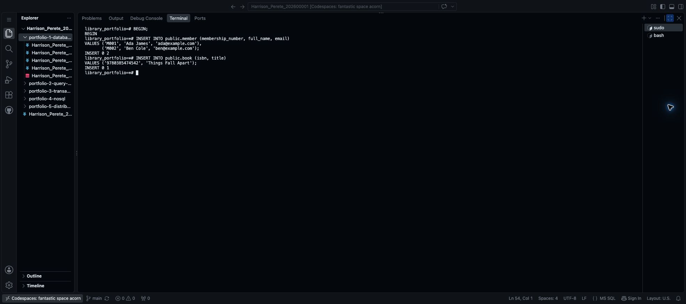

### Add the book

```sql
INSERT INTO public.book (isbn, title)
VALUES ('9780385474542', 'Things Fall Apart');
```

Expected result: `INSERT 0 1`.

Take a screenshot of the command and result: **Mac:** Shift + Command + 4; **Windows:** Windows + Shift + S. Save it as `Harrison_Perete_202600001_P1_InsertBook.png`. Upload it into `portfolio-1-database-design/screenshots` using **Upload…** in the folder's right-click menu.


### Add three copies

The small `SELECT` inside each row finds the book's ID using its ISBN. This avoids guessing an automatically generated ID.

```sql
INSERT INTO public.book_copy (book_id, barcode)
VALUES ((SELECT book_id FROM public.book WHERE isbn = '9780385474542'), 'LIB001'),
       ((SELECT book_id FROM public.book WHERE isbn = '9780385474542'), 'LIB002'),
       ((SELECT book_id FROM public.book WHERE isbn = '9780385474542'), 'LIB003');
```

Expected result: `INSERT 0 3`.

Take a screenshot of the command and result: **Mac:** Shift + Command + 4; **Windows:** Windows + Shift + S. Save it as `Harrison_Perete_202600001_P1_InsertCopies.png`. Upload it into `portfolio-1-database-design/screenshots`.

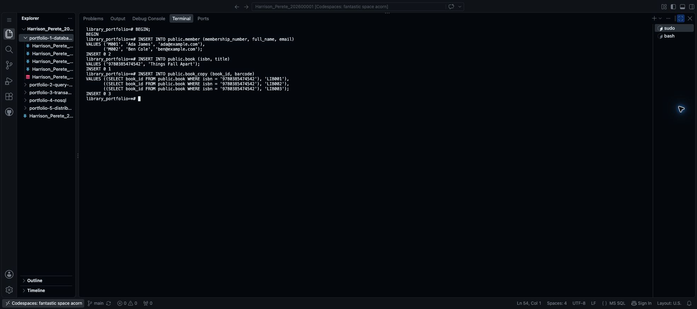

### Add a returned loan

```sql
INSERT INTO public.loan (member_id, copy_id, borrowed_at, due_at, returned_at)
VALUES (
    (SELECT member_id FROM public.member WHERE membership_number = 'M001'),
    (SELECT copy_id FROM public.book_copy WHERE barcode = 'LIB001'),
    '2026-10-01 09:00+00', '2026-10-08 09:00+00', '2026-10-07 10:00+00'
);
```

Expected result: `INSERT 0 1`. Ada borrowed LIB001 and returned it before Ben's later loan.

Take a screenshot of the command and result: **Mac:** Shift + Command + 4; **Windows:** Windows + Shift + S. Save it as `Harrison_Perete_202600001_P1_InsertReturnedLoan.png`. Upload it into `portfolio-1-database-design/screenshots`.

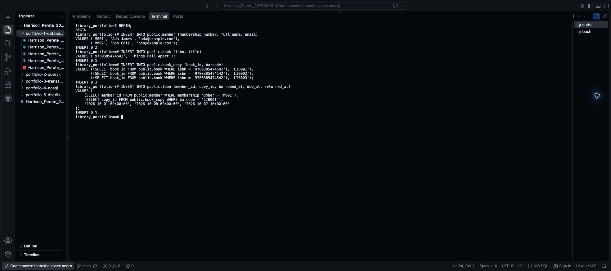

### Add two open loans

```sql
INSERT INTO public.loan (member_id, copy_id, borrowed_at, due_at)
VALUES (
    (SELECT member_id FROM public.member WHERE membership_number = 'M002'),
    (SELECT copy_id FROM public.book_copy WHERE barcode = 'LIB001'),
    '2026-10-15 09:00+00', '2026-10-22 09:00+00'
), (
    (SELECT member_id FROM public.member WHERE membership_number = 'M001'),
    (SELECT copy_id FROM public.book_copy WHERE barcode = 'LIB002'),
    '2026-10-01 09:00+00', '2026-10-08 09:00+00'
);
```

Expected result: `INSERT 0 2`. returned_at is not supplied, so both loans have no return date. LIB003 remains available.

Take a screenshot of the command and result: **Mac:** Shift + Command + 4; **Windows:** Windows + Shift + S. Save it as `Harrison_Perete_202600001_P1_InsertOpenLoans.png`. Upload it into `portfolio-1-database-design/screenshots`.

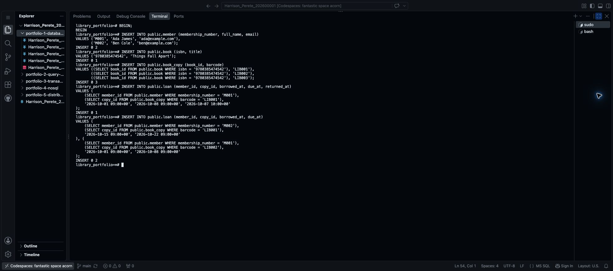

```sql
COMMIT;
```

Expected result: `COMMIT`. The sample records are saved. If an earlier insert fails, use `ROLLBACK;`, correct the script and restart the sample inserts instead of committing.

Take a screenshot of the command and result: **Mac:** Shift + Command + 4; **Windows:** Windows + Shift + S. Save it as `Harrison_Perete_202600001_P1_SampleDataCommit.png`. Upload it into `portfolio-1-database-design/screenshots`.

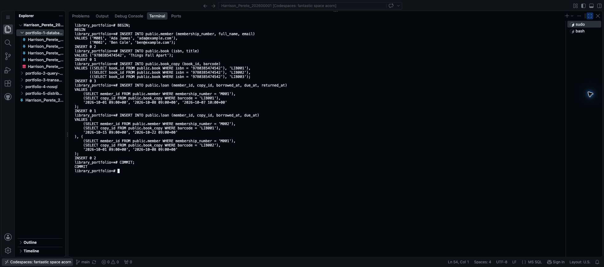

## 4. Test records that should be rejected

Run the following statements **one at a time**, without adding `BEGIN`. Each `ERROR` below is expected: the database is rejecting an invalid record. A rejected statement adds no row, and the next test can run normally.

### A missing required name

```sql
INSERT INTO public.member (membership_number, full_name, email)
VALUES ('TEST_NULL', NULL, 'missing@example.com');
```

Expected result: an error saying that `full_name` violates a **not-null constraint**.

Take a screenshot of the command and error: **Mac:** Shift + Command + 4; **Windows:** Windows + Shift + S. Save it as `Harrison_Perete_202600001_P1_TestRequiredName.png`. Upload it into `portfolio-1-database-design/screenshots`.

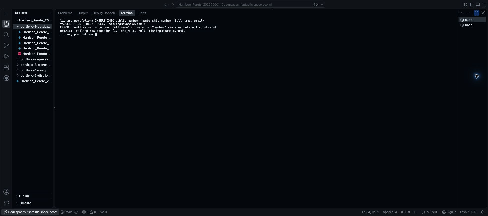

### A repeated email

```sql
INSERT INTO public.member (membership_number, full_name, email)
VALUES ('TEST_EMAIL', 'Test Member', 'ada@example.com');
```

Expected result: a duplicate-key error naming **member_email_key**. Ada's email already belongs to a member.

Take a screenshot of the command and error: **Mac:** Shift + Command + 4; **Windows:** Windows + Shift + S. Save it as `Harrison_Perete_202600001_P1_TestUniqueEmail.png`. Upload it into `portfolio-1-database-design/screenshots`.

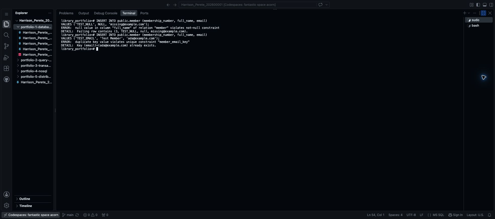

### A copy linked to a missing book

```sql
INSERT INTO public.book_copy (book_id, barcode)
VALUES (-1, 'TEST_BAD_BOOK');
```

Expected result: a foreign-key error naming **book_copy_book_fk**. Book -1 does not exist in this practice database.

Take a screenshot of the command and error: **Mac:** Shift + Command + 4; **Windows:** Windows + Shift + S. Save it as `Harrison_Perete_202600001_P1_TestForeignKey.png`. Upload it into `portfolio-1-database-design/screenshots`.

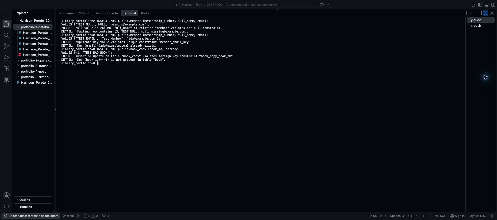

### A due date before borrowing

```sql
INSERT INTO public.loan (member_id, copy_id, borrowed_at, due_at)
VALUES (
    (SELECT member_id FROM public.member WHERE membership_number = 'M001'),
    (SELECT copy_id FROM public.book_copy WHERE barcode = 'LIB003'),
    '2026-10-20 09:00+00', '2026-10-19 09:00+00'
);
```

Expected result: a check-constraint error naming **loan_due_after_borrowing**.

Take a screenshot of the command and error: **Mac:** Shift + Command + 4; **Windows:** Windows + Shift + S. Save it as `Harrison_Perete_202600001_P1_TestDueDate.png`. Upload it into `portfolio-1-database-design/screenshots`.

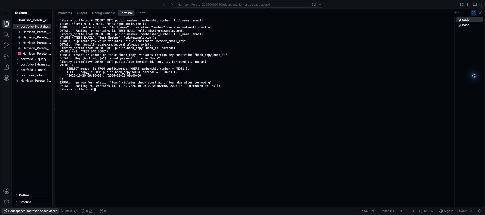

### A return before borrowing

```sql
INSERT INTO public.loan (member_id, copy_id, borrowed_at, due_at, returned_at)
VALUES (
    (SELECT member_id FROM public.member WHERE membership_number = 'M001'),
    (SELECT copy_id FROM public.book_copy WHERE barcode = 'LIB003'),
    '2026-10-20 09:00+00', '2026-10-27 09:00+00', '2026-10-19 09:00+00'
);
```

Expected result: a check-constraint error naming **loan_return_not_before_borrowing**.

Take a screenshot of the command and error: **Mac:** Shift + Command + 4; **Windows:** Windows + Shift + S. Save it as `Harrison_Perete_202600001_P1_TestReturnDate.png`. Upload it into `portfolio-1-database-design/screenshots`.

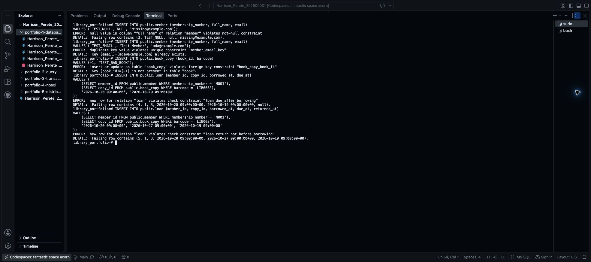

### A second open loan for the same copy

```sql
INSERT INTO public.loan (member_id, copy_id, borrowed_at, due_at)
VALUES (
    (SELECT member_id FROM public.member WHERE membership_number = 'M001'),
    (SELECT copy_id FROM public.book_copy WHERE barcode = 'LIB001'),
    '2026-10-17 09:00+00', '2026-10-24 09:00+00'
);
```

Expected result: a duplicate-key error naming **loan_one_open_copy**. Ben already has an open loan for LIB001.

Take a screenshot of the command and error: **Mac:** Shift + Command + 4; **Windows:** Windows + Shift + S. Save it as `Harrison_Perete_202600001_P1_TestOpenLoan.png`. Upload it into `portfolio-1-database-design/screenshots`.

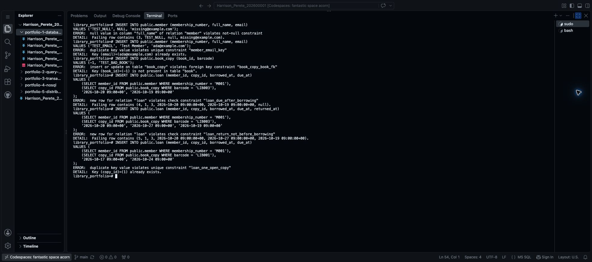

If a test succeeds instead of failing, stop and investigate before continuing. Check the error's rule name too: an error from a different rule does not prove the intended rule works.

## 5. Check that the valid records remain

Run the count query from Section 2 again. Expected counts:

| table_name | row_count |
| --- | ---: |
| member | 2 |
| book | 1 |
| book_copy | 3 |
| loan | 3 |

Take a screenshot of the command and result: **Mac:** Shift + Command + 4; **Windows:** Windows + Shift + S. Save it as `Harrison_Perete_202600001_P1_RecordCounts.png`. Upload it into `portfolio-1-database-design/screenshots`.

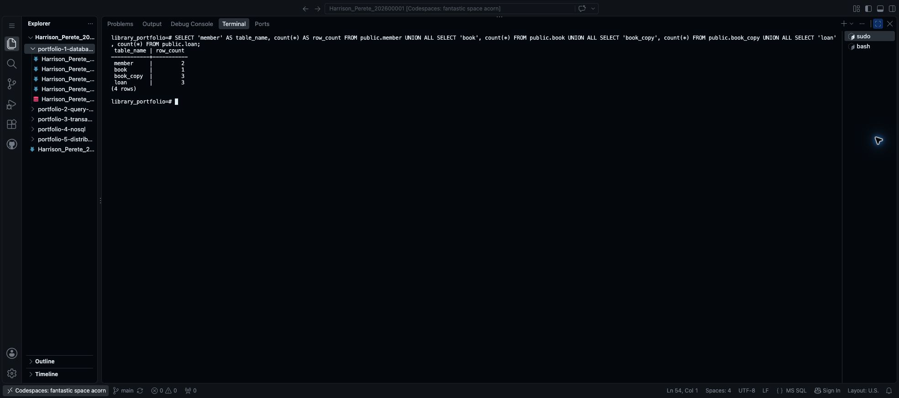

The failed inserts should not add records. Automatically generated IDs may have gaps after failed inserts; that does not mean rows are missing.

## 6. Save your progress

In the separate terminal with the `$` prompt:

```bash
git diff --check
git add portfolio-1-database-design/
git diff --cached --stat
git commit -m "Add sample data and constraint tests"
git push origin main
```

Check that your SQL files and screenshots appear on GitHub. These tests cover the listed constraints, not every possible input or the return-once transaction workflow.

Library files: [sample records](https://github.com/arizonal2014/Harrison_Perete_202600001/blob/main/portfolio-1-database-design/Harrison_Perete_202600001_P1_SampleData.sql) and [constraint tests](https://github.com/arizonal2014/Harrison_Perete_202600001/blob/main/portfolio-1-database-design/Harrison_Perete_202600001_P1_ConstraintTests.sql).

**Next: [Step 11 — Update the README and save Portfolio 1](11_Update_README_And_Save_Portfolio_1.md).**

[Back to Step 9](09_Create_And_Check_Tables.md)
