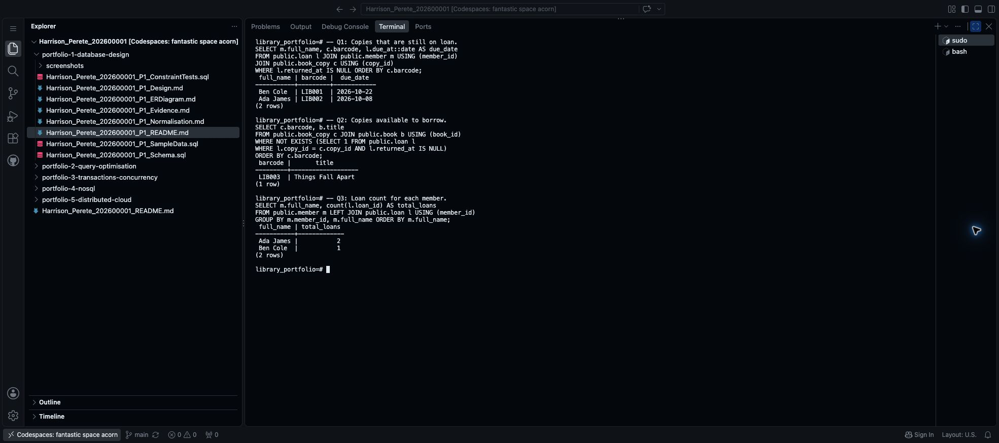

# Step 12 Run useful SQL queries

Portfolio 2 is worth **7 marks**. Section 4 of the [assessment brief](https://lms-assets.miva.university/course-materials/mit-8103-advanced-database-systems-ca-september-cohort-2026.pdf) asks for SQL queries, results, execution plans, optimisation evidence and a short performance analysis.

Start with three queries using the library records from Portfolio 1. Execution plans and the index follow in Step 13. This tutorial uses **three screenshots for Portfolio 2 altogether**; that number is a tutorial choice, not an assessment rule.

## 1. Open the database

Use your existing PostgreSQL terminal. The library prompt is `library_portfolio=#`.

If you closed it, run this in the Codespaces `$` terminal:

```bash
sudo service postgresql start
sudo runuser -u postgres -- psql -d library_portfolio
```

For another PostgreSQL setup, reconnect using your usual method. Do not recreate the tables or sample records.

Run this in PostgreSQL so results do not open in a separate scrolling view:

```text
\pset pager off
```

Maximise the terminal panel using its top-right maximise button. Press **Ctrl+L** to clear old output from view; this does not delete records.

## 2. Find copies still on loan

Run the complete statement, ending with `;`:

```sql
-- Q1: Copies that are still on loan.
SELECT m.full_name, c.barcode, l.due_at::date AS due_date
FROM public.loan l JOIN public.member m USING (member_id)
JOIN public.book_copy c USING (copy_id)
WHERE l.returned_at IS NULL ORDER BY c.barcode;
```

`JOIN` connects related tables. `IS NULL` finds loans without a return date. `::date` displays just the date.

Expected result:

| full_name | barcode | due_date |
| --- | --- | --- |
| Ben Cole | LIB001 | 2026-10-22 |
| Ada James | LIB002 | 2026-10-08 |

## 3. Find available copies

```sql
-- Q2: A copy is available when it has no open loan.
SELECT c.barcode, b.title
FROM public.book_copy c JOIN public.book b USING (book_id)
WHERE NOT EXISTS (
    SELECT 1 FROM public.loan l
    WHERE l.copy_id = c.copy_id AND l.returned_at IS NULL
)
ORDER BY c.barcode;
```

`NOT EXISTS` keeps a copy only when no open loan is found for it. An old, returned loan does not make a copy unavailable.

Expected result:

| barcode | title |
| --- | --- |
| LIB003 | Things Fall Apart |

## 4. Count loans for each member

```sql
-- Q3: Count all loans, including returned ones.
SELECT m.full_name, count(l.loan_id) AS total_loans
FROM public.member m LEFT JOIN public.loan l USING (member_id)
GROUP BY m.member_id, m.full_name ORDER BY m.full_name;
```

`GROUP BY` gives one result per member. `LEFT JOIN` also includes members with no loans; their count would be zero.

Expected result:

| full_name | total_loans |
| --- | ---: |
| Ada James | 2 |
| Ben Cole | 1 |

Take **one screenshot** showing the three queries and their results together. If the text does not fit, save the full results as text rather than shrinking them until unreadable.

- **Mac:** Cmd+Shift+4, then select the terminal area.
- **Windows:** Win+Shift+S, select the terminal area, then save from Snipping Tool.
- Rename the saved image `Harrison_Perete_202600001_P2_QueryResults.png` using **your own name and student ID**. Keep `.jpg` instead if your image was saved as JPEG.
- In Codespaces Explorer, right-click `portfolio-2-query-optimisation`, choose **New Folder**, and name it `screenshots`.
- Right-click that `screenshots` folder, choose **Upload…**, and select your renamed image.



## 5. Save the SQL

In `portfolio-2-query-optimisation`, create `Harrison_Perete_202600001_P2_Queries.sql`, replacing the prefix with yours. Paste the three queries you ran, including their comments, and save with **Cmd+S** or **Ctrl+S**.

The complete library file is [P2_Queries.sql](Harrison_Perete_202600001_P2_Queries.sql). Save SQL in this file, not terminal prompts or result tables.

## Prompt for a different case study

```text
Create three PostgreSQL queries for my MIT 8103 Portfolio 2.

MY CASE STUDY AND RULES
[PASTE MY AGREED CASE-STUDY DESCRIPTION]

MY ACTUAL SCHEMA AND SAMPLE DATA
[ATTACH MY PORTFOLIO 1 SCHEMA AND SAMPLE-DATA SQL FILES]

Use the library example's size and structure:
1. A useful list joining related tables and filtering records.
2. An availability or missing-related-record check using NOT EXISTS,
   or another simple query that fits my actual business rules.
3. A grouped count using LEFT JOIN so zero-count records are retained.

For each query provide a short heading, commented SQL, one sentence
explaining it, and the expected result derived from my sample data.
Use my actual table and column names, not renamed library examples.
Use stable ordering and fixed dates where needed for repeatable results.
Do not change data or invent results. If required files are missing,
ask for them. Keep this to three queries; no execution plans yet.
```

Run your queries and compare the actual results with the predictions. If they differ, check the query and data before saving your explanation.

## Save to GitHub

Use the other terminal with the `$` prompt. Run each line separately:

```bash
git diff --check
git add portfolio-2-query-optimisation/
git diff --cached --stat
git commit -m "Add Portfolio 2 queries and results"
git push origin main
```

Check the staged filenames before committing. Open the SQL file and screenshot on GitHub to confirm they arrived.

**Next: [Step 13 — Compare execution plans and add an index](13_Compare_Plans_And_Add_Index.md).**

[Back to Step 11](11_Update_README_And_Save_Portfolio_1.md)
