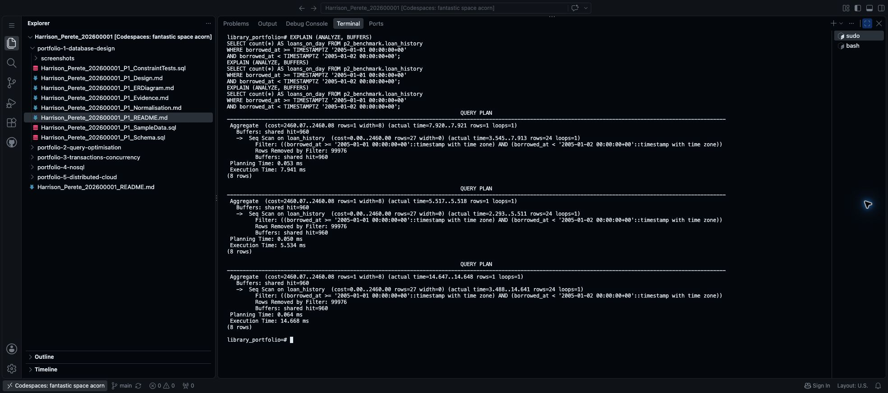
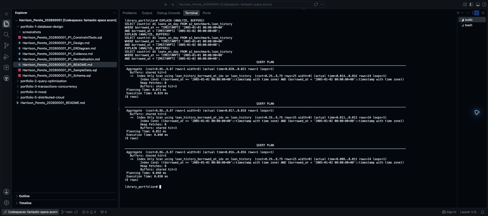

# Step 13 Compare execution plans and add an index

This completes the execution-plan, indexing and brief performance-analysis parts of Portfolio 2 in Section 4 of the [assessment brief](https://lms-assets.miva.university/course-materials/mit-8103-advanced-database-systems-ca-september-cohort-2026.pdf).

An execution plan shows how PostgreSQL finds results. An index helps it find selected rows without checking the whole table. With only three library loans, a speed comparison would tell us little. Use a separate test table with more records.

## 1. Add more example records for the speed test

The library currently has only three loan records. We need more records to see whether an index makes a difference. The SQL below creates **100,000 made-up borrowing records automatically**; you do not type them individually.

They go into a new table called `loan_history`. Your original library tables stay unchanged.

At `library_portfolio=#`, run each block below **once**, in order.

```sql
CREATE SCHEMA p2_benchmark;
```

Expected: `CREATE SCHEMA`. This creates a named area called `p2_benchmark` for the test table, within the same database.

Next, run this complete block:

```sql
-- Create 100,000 example borrowing records for the speed test.
-- Each record has a borrowing date, due date and return date.
CREATE TABLE p2_benchmark.loan_history AS
SELECT g AS loan_id, m.member_id, c.copy_id,
       TIMESTAMPTZ '2000-01-01 00:00:00+00' + g * INTERVAL '1 hour' AS borrowed_at,
       TIMESTAMPTZ '2000-01-01 00:00:00+00' + g * INTERVAL '1 hour' + INTERVAL '7 days' AS due_at,
       TIMESTAMPTZ '2000-01-01 00:00:00+00' + g * INTERVAL '1 hour' + INTERVAL '30 minutes' AS returned_at
FROM generate_series(1, 100000) AS g
CROSS JOIN public.member m CROSS JOIN public.book_copy c
WHERE m.membership_number = 'M001' AND c.barcode = 'LIB001';
```

Expected: `SELECT 100000`. This means PostgreSQL created the table with **100,000 rows**.

Here is how the first two made-up records are dated:

| Record | Borrowed | Returned |
| --- | --- | --- |
| 1 | January 1, 2000 at 01:00 | January 1, 2000 at 01:30 |
| 2 | January 1, 2000 at 02:00 | January 1, 2000 at 02:30 |

The pattern continues until there are 100,000 records. All use Ada's member ID and copy LIB001. These are test records, not real borrowing activity.

The main parts of the SQL mean:

- `generate_series(1, 100000)` produces the numbers 1 to 100,000. `g` is the number for each row.
- `g * INTERVAL '1 hour'` moves each borrowing time forward by another hour.
- `INTERVAL '7 days'` sets the due date seven days after borrowing; `INTERVAL '30 minutes'` sets the return time 30 minutes after borrowing.
- The final `WHERE` selects the existing member M001 and copy LIB001.

This test table does not copy the keys or constraints from Portfolio 1. It is only used to compare query speed.

Now check how many rows were created:

```sql
ANALYZE p2_benchmark.loan_history;
SELECT count(*) AS test_rows FROM p2_benchmark.loan_history;
```

Expected: `ANALYZE`, then **100000**. `ANALYZE` helps PostgreSQL choose how to search the table; `count(*)` counts its rows. If the count differs, stop and check that M001 and LIB001 exist in your Portfolio 1 data.

If a schema or table already exists, do not delete it or rerun the setup. Check where you stopped. Once the index exists, this table no longer provides an unindexed baseline; use a fresh, separately named test table if you need to repeat the whole experiment.

## 2. Count loans on one day

```sql
SELECT count(*) AS loans_on_day FROM p2_benchmark.loan_history
WHERE borrowed_at >= TIMESTAMPTZ '2005-01-01 00:00:00+00'
  AND borrowed_at < TIMESTAMPTZ '2005-01-02 00:00:00+00';
```

Expected: **24**. The date range includes the start of January 1 and excludes the start of January 2.

## 3. Measure before adding the index

```sql
EXPLAIN (ANALYZE, BUFFERS)
SELECT count(*) AS loans_on_day FROM p2_benchmark.loan_history
WHERE borrowed_at >= TIMESTAMPTZ '2005-01-01 00:00:00+00'
  AND borrowed_at < TIMESTAMPTZ '2005-01-02 00:00:00+00';
```

This runs the query and shows its plan, execution time and buffer use. Buffers are blocks of database data accessed during execution. `cost` is an estimate, **not milliseconds**.

1. Run it once as a warm-up; ignore that time.
2. Press **Ctrl+L** to clear the display.
3. Run the same statement three more times. Write down each **Execution Time** in milliseconds.

Expected plan: `Seq Scan on loan_history`. It checks all 100,000 rows, keeps 24 and removes 99,976. The top `Aggregate` counts the matching rows and returns one count value.

Take **one screenshot** showing the three measured plans. Name it `Surname_Firstname_StudentID_P2_BeforeIndex.png` and upload it to your Portfolio 2 `screenshots` folder, as in Step 12. Keep the actual image extension if different.



## 4. Add the index and measure again

```sql
CREATE INDEX loan_history_borrowed_at_idx
    ON p2_benchmark.loan_history (borrowed_at);
```

Expected: `CREATE INDEX`. This indexes the column used in the date filter.

Run the **same EXPLAIN statement from Section 3**, again with one warm-up followed by three measured runs. Do not change the query, rows or PostgreSQL settings.

Expected: an index-based scan naming `loan_history_borrowed_at_idx`, often `Index Only Scan`. Your exact plan and times can differ. Do not force a plan or claim a speed improvement your results do not show.

Take **one screenshot** of the three measured plans. Name it `Surname_Firstname_StudentID_P2_AfterIndex.png` and upload it to the same folder.



Run the count query from Section 2 again. It should still return **24**.

## 5. Save your SQL and results

Create `Surname_Firstname_StudentID_P2_Optimisation.sql` in `portfolio-2-query-optimisation`. Save the setup, count query, before-plan command, index command and after-plan command **in that order**. Add comments explaining the warm-up and three repeated measurements. The complete library script is [P2_Optimisation.sql](Harrison_Perete_202600001_P2_Optimisation.sql).

Now open your **existing Portfolio 2 README**, created in Step 3. Replace its empty contents with these headings and your own results:

```markdown
# Portfolio 2 Query Processing and Optimisation

## Queries and results
[State what the three queries find and what they returned.]

## Index comparison
[Name the test table, row count, unchanged query and added index.]

| Measurement | Before index | After index |
| --- | --- | --- |
| Scan type | [actual plan] | [actual plan] |
| Three execution times (ms) | [your three values] | [your three values] |
| Median time (ms) | [middle value] | [middle value] |
| Shared buffer hits, third run | [actual value] | [actual value] |

## Performance analysis
[Explain the plan change and measured result in one short paragraph.
Include a limitation and the storage/write cost of adding an index.]

## Files
[Link your Queries.sql, Optimisation.sql and screenshots/ folder.]

## Reference
[Link documentation you used.]
```

The **median** is the middle value after sorting your three times from smallest to largest. Do not copy the library timings into a different run.

### Library results

The [completed library README](https://github.com/arizonal2014/Harrison_Perete_202600001/blob/main/portfolio-2-query-optimisation/Harrison_Perete_202600001_P2_README.md) uses the headings above, with these observed results:

The three queries return two open loans, one available copy (LIB003), and loan totals of two for Ada and one for Ben. The performance test counts 24 loans on January 1, 2005 from 100,000 generated records.

| Measurement | Before index | After index |
| --- | --- | --- |
| Scan type | Seq Scan | Index Only Scan |
| Three execution times (ms) | 7.941, 5.534, 14.668 | 0.039, 0.040, 0.030 |
| Median time (ms) | 7.941 | 0.039 |
| Shared buffer hits, third run | 960 | 3 |

The index reduces the work needed for this narrow date range. Before indexing, PostgreSQL checks all 100,000 rows; afterwards, the index scan finds 24 matching entries. The measured median falls from 7.941 ms to 0.039 ms. Both measured phases use cached data, and Codespaces timing varies, so this is not a production benchmark. The index also uses storage and adds maintenance work when rows change.

Reference: [PostgreSQL — Using EXPLAIN](https://www.postgresql.org/docs/16/using-explain.html).

## Prompts for your own case study

Use the first prompt **before** running your performance experiment:

```text
Help me demonstrate indexing for MIT 8103 Portfolio 2 using my own case.

MY CASE, ACTUAL SCHEMA AND SAMPLE DATA
[ATTACH MY AGREED CASE DESCRIPTION, SCHEMA AND SAMPLE-DATA FILES]

Use a separate p2_benchmark schema and one clearly labelled synthetic
history table so my Portfolio 1 records stay unchanged. Provide SQL to
generate 100,000 plausible rows using my existing identifiers, refresh
statistics with ANALYZE, and check the total count.

Choose one useful, selective date-range or identifier query. Provide
its expected result derived from the generated data, EXPLAIN (ANALYZE,
BUFFERS) before indexing, one suitable B-tree index, and the identical
EXPLAIN query afterwards. Avoid indexes already present on the test table.
Do not delete tables, change planner settings or invent measured timings.
Explain each block in one simple sentence. State that setup runs once,
and each plan runs once for warm-up then three times for measurement.
If essential inputs are missing, ask for them rather than guessing names.
```

Use this second prompt **after** you have run the commands:

```text
Draft my Portfolio 2 README from the work and observed results below.

MY FILES AND OBSERVED OUTPUT
[ATTACH MY QUERIES AND OPTIMISATION SQL. PASTE ACTUAL QUERY RESULTS,
BEFORE/AFTER PLANS AND THREE MEASURED TIMES FOR EACH PHASE.
LIST MY EXACT FILENAMES AND SAVED SCREENSHOTS.]

Use exactly these headings:
# Portfolio 2 Query Processing and Optimisation
## Queries and results
## Index comparison
## Performance analysis
## Files
## Reference

Keep it short, like the library example. Summarise the three query results.
Include a before/after table with scan type, three execution times,
median time and top-level shared buffer hits from the third measured run.
Explain the observed plan and performance in one paragraph, including
timing limitations and index storage/write overhead. Use actual relative
file links and supplied references. Do not invent results or claim that
an index guarantees faster queries. Ask for missing evidence first.
```

## 6. Save to GitHub

Save the edited files with **Cmd+S** or **Ctrl+S**. In the `$` terminal, run each line separately:

```bash
git diff --check
git diff
git add portfolio-2-query-optimisation/
git diff --cached --stat
git commit -m "Add index comparison and Portfolio 2 analysis"
git push origin main
git status
```

Press **q** to leave a scrolling diff. Review the staged file list before committing. On GitHub, check your README, SQL links and three screenshots.

**Portfolio 2 evidence:** SQL queries and results (Step 12), execution plans and index (Step 13), and the short README comparison.

**Next: [Step 14 — Save or undo a transaction](14_Commit_And_Rollback.md).**

[Back to Step 12](12_Run_SQL_Queries.md)
