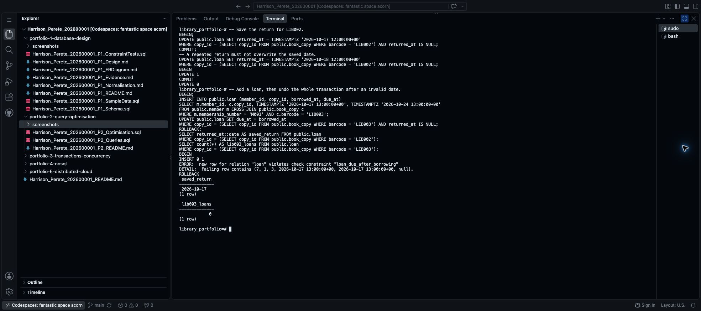

# Step 14 Save or undo a transaction

Portfolio 3 is worth **7 marks**. Section 4 of the [assessment brief](https://lms-assets.miva.university/course-materials/mit-8103-advanced-database-systems-ca-september-cohort-2026.pdf) asks for commit, rollback, isolation, and a concurrency issue or control mechanism, with outputs or screenshots.

This step covers **commit and rollback**. Step 15 covers two sessions working at the same time. Use **three screenshots altogether** for Portfolio 3.

A transaction groups database changes:

- `BEGIN` starts the group.
- `COMMIT` saves its changes.
- `ROLLBACK` undoes its unsaved changes.

## 1. Check where you are starting

Use the PostgreSQL terminal connected to **the database you created in Step 8**, as in Step 12. The library example uses `library_portfolio`; yours may have a different name.

The SQL below is for the library example. For another case study, use the prompt at the end of this step to get SQL for your own tables.

For the library, run:

```sql
SELECT c.barcode, l.returned_at::date AS return_date
FROM public.loan l JOIN public.book_copy c USING (copy_id)
ORDER BY c.barcode, l.borrowed_at;
```

Expected from Portfolio 1:

| barcode | return_date |
| --- | --- |
| LIB001 | 2026-10-07 |
| LIB001 | empty |
| LIB002 | empty |

An empty return date means the copy has not been returned. LIB003 has no loan yet. If your starting records differ, check where you stopped before continuing. **Run this exercise once; do not recreate your tables.**

Maximise the terminal panel and press **Ctrl+L** to clear old output from view.

## 2. Save a book return with COMMIT

Run each statement in order:

```sql
BEGIN;

-- Record the return only if this loan has not already been returned.
UPDATE public.loan
SET returned_at = TIMESTAMPTZ '2026-10-17 12:00:00+00'
WHERE copy_id = (SELECT copy_id FROM public.book_copy WHERE barcode = 'LIB002')
  AND returned_at IS NULL;

COMMIT;
```

Expected: `BEGIN`, `UPDATE 1`, then `COMMIT`. One loan now has a saved return date.

Try recording that return again, using a different date:

```sql
UPDATE public.loan
SET returned_at = TIMESTAMPTZ '2026-10-18 12:00:00+00'
WHERE copy_id = (SELECT copy_id FROM public.book_copy WHERE barcode = 'LIB002')
  AND returned_at IS NULL;
```

Expected: **`UPDATE 0`**. The `returned_at IS NULL` condition prevents this command from overwriting an existing return. It is part of this return workflow; other unrestricted UPDATE commands could still change the date.

## 3. Undo changes after an error

Start a new transaction and add a loan for LIB003:

```sql
BEGIN;

INSERT INTO public.loan (member_id, copy_id, borrowed_at, due_at)
SELECT m.member_id, c.copy_id,
       TIMESTAMPTZ '2026-10-17 13:00:00+00', TIMESTAMPTZ '2026-10-24 13:00:00+00'
FROM public.member m CROSS JOIN public.book_copy c
WHERE m.membership_number = 'M001' AND c.barcode = 'LIB003';
```

Expected: `BEGIN`, then **`INSERT 0 1`**, meaning one row was added inside this transaction. It has not been committed.

Now deliberately give that loan an invalid due date:

```sql
UPDATE public.loan SET due_at = borrowed_at
WHERE copy_id = (SELECT copy_id FROM public.book_copy WHERE barcode = 'LIB003')
  AND returned_at IS NULL;
```

Expected: an error naming **`loan_due_after_borrowing`**. The due date must be later than borrowing, not equal to it.

Run this next:

```sql
ROLLBACK;
```

Expected: `ROLLBACK`. This undoes the whole second transaction, including the valid loan added before the error. It does not undo the earlier committed return.

Check both results:

```sql
SELECT returned_at::date AS saved_return FROM public.loan
WHERE copy_id = (SELECT copy_id FROM public.book_copy WHERE barcode = 'LIB002');

SELECT count(*) AS lib003_loans FROM public.loan
WHERE copy_id = (SELECT copy_id FROM public.book_copy WHERE barcode = 'LIB003');
```

Expected: **2026-10-17** for the saved return and **0** loans for LIB003. Failed inserts can leave gaps in generated IDs; do not renumber them.

Take **one screenshot** showing the commit, repeated-return result, rollback error and final checks. Name it `Surname_Firstname_StudentID_P3_CommitRollback.png`, using your own details. Keep `.jpg` if that is your image format.

- Mac: **Cmd+Shift+4**. Windows: **Win+Shift+S**, then save the image.
- Create a `screenshots` folder inside `portfolio-3-transactions-concurrency` in Codespaces Explorer.
- Rename your image, then right-click that folder → **Upload…** and select it.



## 4. Save the SQL

Create `Surname_Firstname_StudentID_P3_Transactions.sql` inside `portfolio-3-transactions-concurrency`. Save the SQL you ran in order, with short comments. Do not copy terminal prompts or error output into the SQL file.

The complete library example is [P3_Transactions.sql](Harrison_Perete_202600001_P3_Transactions.sql).

## Prompt for your own case study

Attach the files named below from your repository. You do not need to remember which records changed: the AI should first give you queries to check them. Run those queries and paste their results back into the same chat.

```text
Create a simple commit and rollback exercise for MIT 8103 Portfolio 3.

MY CASE AND CURRENT DATABASE
[ATTACH MY PORTFOLIO 1 README, SCHEMA.SQL AND SAMPLE-DATA SQL FILES.
ENTER THE DATABASE NAME I CREATED IN STEP 8.]

First give me one or two simple SELECT queries to check the records
needed for this exercise. Wait for me to run them and paste the results.
Use those results to choose suitable records; do not assume the sample
data is unchanged. Then provide the exercise below.

Follow this structure, using my actual tables and rules:
1. A starting-data check with the expected rows.
2. BEGIN, one meaningful update, and COMMIT. Use a condition that
   prevents repeating the operation when appropriate; show a repeat check.
3. BEGIN, one valid change, then a deliberate violation of an existing
   constraint. Show the expected constraint error and ROLLBACK.
4. Queries proving that the committed change remains and the valid
   change from the rolled-back transaction is gone.

Give each SQL block, its expected result, and one simple sentence of
explanation. Use existing identifiers and fixed valid dates where relevant.
Do not delete records, disable constraints or introduce new features.
Explain that setup matters and the exercise runs once. Request missing
inputs rather than inventing identifiers. Results are predictions until run.
Use one screenshot for this exercise. Do not add the two-session test yet.
```

## Save to GitHub

Save your file. In the other terminal with the `$` prompt, run each line separately:

```bash
git diff --check
git add portfolio-3-transactions-concurrency/
git diff --cached --stat
git commit -m "Demonstrate commit and rollback"
git push origin main
```

Check the staged filenames before committing. These tests change the live library data; earlier Portfolio 1 and 2 screenshots remain records of those earlier runs.

**Next: [Step 15 — Test two sessions borrowing the same copy](15_Test_Two_Database_Sessions.md).**

[Back to Step 13](13_Compare_Plans_And_Add_Index.md)
