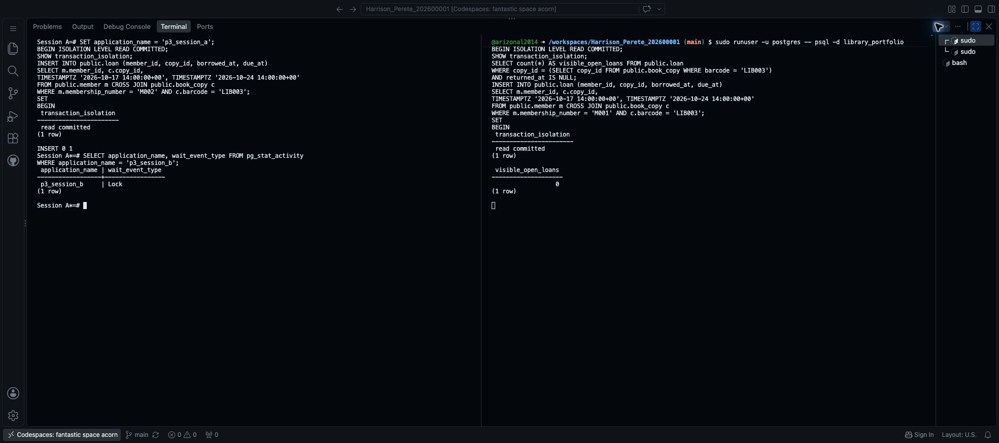
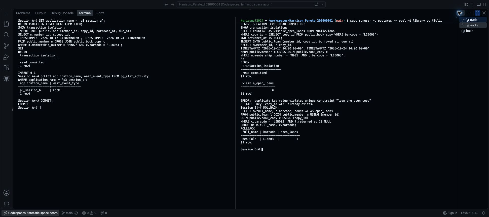

# Step 15 Test two sessions borrowing the same copy

This covers **isolation and concurrency control** for Portfolio 3 in Section 4 of the [assessment brief](https://lms-assets.miva.university/course-materials/mit-8103-advanced-database-systems-ca-september-cohort-2026.pdf).

Imagine two staff members trying to lend LIB003 to different members at the same time. Two database sessions let us test this without needing two computers.

## 1. Open two PostgreSQL sessions

Keep the PostgreSQL terminal from Step 14 open. This is **Session A**, on the left.

1. With that terminal selected, open the command palette: **Cmd+Shift+P** on Mac or **Ctrl+Shift+P** on Windows.
2. Type `Terminal: Split Terminal` and select that exact command. A second terminal opens beside the first.
3. In the new `$` terminal on the right, run:

```bash
sudo runuser -u postgres -- psql -d library_portfolio
```

This is **Session B**. Both connect to the same database. If you use PostgreSQL elsewhere, open a second independent connection to that database.

For your own case study, replace `library_portfolio` in the connection command with the database name you created in Step 8. Use your own case-study SQL from the prompt below, not the library borrowing commands.

To make the prompts easy to tell apart, run this **in A**:

```text
\set PROMPT1 'Session A%x%R%# '
```

Run these **in B**:

```text
\pset pager off
\set PROMPT1 'Session B%x%R%# '
```

These only label the prompts and keep results visible. Press **Ctrl+L** in each terminal to clear old output. Hide the Explorer sidebar if you need more space.

**Important: follow A → B → A → B below. Do not paste all the commands into one session.**

## 2. Session A: start a loan, but do not save it yet

Run in **A**:

```sql
SET application_name = 'p3_session_a';
BEGIN ISOLATION LEVEL READ COMMITTED;
SHOW transaction_isolation;

INSERT INTO public.loan (member_id, copy_id, borrowed_at, due_at)
SELECT m.member_id, c.copy_id,
       TIMESTAMPTZ '2026-10-17 14:00:00+00', TIMESTAMPTZ '2026-10-24 14:00:00+00'
FROM public.member m CROSS JOIN public.book_copy c
WHERE m.membership_number = 'M002' AND c.barcode = 'LIB003';
```

Expected: `read committed` and **`INSERT 0 1`**. Session A has added Ben's loan but has not committed it. **Stop here in A.**

`READ COMMITTED` means a normal SELECT does not see another session's uncommitted changes. The application name labels the connection for the waiting check below.

## 3. Session B: try to borrow that same copy

Run in **B**:

```sql
SET application_name = 'p3_session_b';
BEGIN ISOLATION LEVEL READ COMMITTED;
SHOW transaction_isolation;

SELECT count(*) AS visible_open_loans FROM public.loan
WHERE copy_id = (SELECT copy_id FROM public.book_copy WHERE barcode = 'LIB003')
  AND returned_at IS NULL;
```

Expected: `read committed` and **0** visible open loans. B cannot yet see A's new loan because A has not committed.

Still in **B**, run:

```sql
INSERT INTO public.loan (member_id, copy_id, borrowed_at, due_at)
SELECT m.member_id, c.copy_id,
       TIMESTAMPTZ '2026-10-17 14:00:00+00', TIMESTAMPTZ '2026-10-24 14:00:00+00'
FROM public.member m CROSS JOIN public.book_copy c
WHERE m.membership_number = 'M001' AND c.barcode = 'LIB003';
```

**Expected: B waits.** There is no new prompt or `INSERT 0 1` yet. This is not a frozen terminal: the existing `loan_one_open_copy` index detects a possible conflict and waits for A to finish. Do not enter more commands in B yet.

## 4. Session A: check the wait, then commit

Switch back to **A** and run:

```sql
SELECT application_name, wait_event_type FROM pg_stat_activity
WHERE application_name = 'p3_session_b';
```

Expected:

| application_name | wait_event_type |
| --- | --- |
| p3_session_b | Lock |

Take **one screenshot** of both terminals, showing A's uncommitted insert, B's count of zero and the lock wait. Name it `Surname_Firstname_StudentID_P3_SessionsWaiting.png`. Upload it to your Portfolio 3 `screenshots` folder, as in Step 14.



Now run **in A**:

```sql
COMMIT;
```

Expected: `COMMIT`. Ben's loan is now saved.

## 5. Session B: check the outcome

B should now show a duplicate-key error naming **`loan_one_open_copy`**. Its attempted loan for Ada is rejected because Ben already has that copy on loan.

Run **in B**:

```sql
ROLLBACK;

SELECT m.full_name, c.barcode, count(*) AS open_loans
FROM public.loan l JOIN public.member m USING (member_id)
JOIN public.book_copy c USING (copy_id)
WHERE c.barcode = 'LIB003' AND l.returned_at IS NULL
GROUP BY m.full_name, c.barcode;
```

Expected:

| full_name | barcode | open_loans |
| --- | --- | ---: |
| Ben Cole | LIB003 | 1 |

Take **one screenshot** of both terminals showing A's commit, B's error, rollback and final result. Name it `Surname_Firstname_StudentID_P3_ConcurrencyResult.png` and upload it to the same folder. Keep your actual image extension.



**What happened:** B's earlier count of zero did not guarantee that the copy was available. The unique index, not the count query or isolation level alone, prevented two open loans. Both transactions are now finished; no locks are deliberately left waiting.

If B does not wait, check that A has not already committed and both sessions use the same database. If you get a different error, resolve it before describing the test as successful. To abandon an interrupted test, cancel B's waiting command with **Ctrl+C**, then run `ROLLBACK;` in both sessions. Do not delete loans to force the expected result.

## 6. Save the scripts and README

In `portfolio-3-transactions-concurrency`, create these files with **your own prefix**:

- `Surname_Firstname_StudentID_P3_SessionA.sql`: A's commands, with comments marking where to stop and switch sessions.
- `Surname_Firstname_StudentID_P3_SessionB.sql`: B's commands, with the same stop/switch comments.

Library examples: [SessionA.sql](Harrison_Perete_202600001_P3_SessionA.sql) and [SessionB.sql](Harrison_Perete_202600001_P3_SessionB.sql). These files document the order; **do not run either whole file in one go**.

Open your existing Portfolio 3 README from Step 3. Use the following structure, replacing the library facts with your own observed results:

```markdown
# Portfolio 3 Transactions and Concurrency

## Commit and rollback
The return for LIB002 is committed with a return date of October 17, 2026.
A repeated return affects zero rows because the UPDATE only changes an
open loan. In the next transaction, a valid LIB003 loan is added before
an invalid due date causes an error. ROLLBACK removes that new loan;
the earlier committed return remains.

## Isolation and concurrency control
Two PostgreSQL sessions use READ COMMITTED. A inserts a LIB003 loan for
Ben without committing. B sees zero open loans, then tries to insert one
for Ada. B waits, with wait_event_type shown as Lock. After A commits,
B receives a loan_one_open_copy duplicate-key error. B rolls back, and
the final query shows exactly one open LIB003 loan, belonging to Ben.

## Conclusion
COMMIT saves changes and ROLLBACK undoes a transaction's unsaved changes.
READ COMMITTED hides other sessions' uncommitted records. The unique
index prevents two open loans even when an earlier availability check
finds none. The return-once check belongs to the demonstrated UPDATE
workflow; it does not prevent every possible direct database edit.

## Files
[Link your Transactions.sql, SessionA.sql, SessionB.sql and screenshots/.]

## References
[Link the PostgreSQL documentation used below.]
```

The SQL and screenshots support these statements. Earlier portfolio outputs describe earlier database states; the committed return and new loan now change the live records. No changes are made to Portfolio 2's separate speed-test table.

See the [completed library README](https://github.com/arizonal2014/Harrison_Perete_202600001/blob/main/portfolio-3-transactions-concurrency/Harrison_Perete_202600001_P3_README.md) for the finished example with file links.

References: [PostgreSQL transactions](https://www.postgresql.org/docs/16/tutorial-transactions.html), [transaction isolation](https://www.postgresql.org/docs/16/transaction-iso.html), and [unique indexes](https://www.postgresql.org/docs/16/indexes-unique.html).

## Prompts for another case study

Before the two-session exercise:

```text
Design a simple two-session concurrency test for MIT 8103 Portfolio 3.

MY ACTUAL CASE, SCHEMA AND CURRENT RECORDS
[ATTACH MY PORTFOLIO 1 README AND SCHEMA SQL, PLUS MY TRANSACTIONS.SQL
FROM STEP 14. PASTE THE TWO FINAL CHECK RESULTS FROM THAT EXERCISE.]

If you need more information about my current records, first give me
simple SELECT queries to run and wait for their results. Do not ask me
to work out which records changed from memory.

Follow the library example's A → B → A → B sequence using my own rules.
Use two independent PostgreSQL connections and explicitly show the
isolation level. Where suitable, demonstrate an existing unique constraint
or unique partial index preventing two conflicting operations. Explain
what B can see before A commits, when it waits, and the final result.
Include a starting-data check, SQL for each session, clear STOP/switch
instructions, expected results, rollback after an expected error, and a
final query proving the rule held. Label expected results as predictions.

Do not disable constraints, delete data, assume hard-coded generated IDs,
or run both sessions as a single script. If my schema needs a different
control mechanism, explain it and propose the smallest suitable test.
Do not claim that isolation alone prevents every conflicting operation.
Keep explanations short. Use two screenshots: waiting and final outcome.
```

After running your tests, use this to draft the README:

```text
Draft my MIT 8103 Portfolio 3 README in simple language.

MY WORK AND OBSERVED RESULTS
[ATTACH MY THREE SQL FILES AND PASTE THE ACTUAL COMMIT, ROLLBACK,
ISOLATION, WAITING/ERROR AND FINAL-CHECK OUTPUTS.
LIST MY EXACT FILENAMES AND SAVED SCREENSHOTS.]

Use exactly these headings:
# Portfolio 3 Transactions and Concurrency
## Commit and rollback
## Isolation and concurrency control
## Conclusion
## Files
## References

Use one short paragraph under each of the first three sections, matching
the library example's length. Explain the actual controls and their limits.
Link my actual SQL files and screenshots/ using relative paths. Cite only
documentation used. Do not invent observations or copy library facts into
my case. If evidence is missing or unexpected, ask what needs checking
instead of claiming the exercise succeeded.
```

## 7. Save to GitHub

Save your files with **Cmd+S** or **Ctrl+S**. Use the separate `$` terminal for Git, not either PostgreSQL prompt. Run each line separately:

```bash
git diff --check
git diff
git add portfolio-3-transactions-concurrency/
git diff --cached --stat
git commit -m "Demonstrate isolation and concurrency control"
git push origin main
git status
```

Press **q** to leave a scrolling diff. Check the staged filenames before committing. Open the README on GitHub and check its links and three screenshots.

**Portfolio 3 evidence:** commit and rollback (Step 14), isolation and the concurrency control (Step 15), SQL files, three screenshots and a short README.

**Next: [Step 16 — Set up MongoDB in Codespaces](16_Set_Up_MongoDB.md).**

[Back to Step 14](14_Commit_And_Rollback.md)
