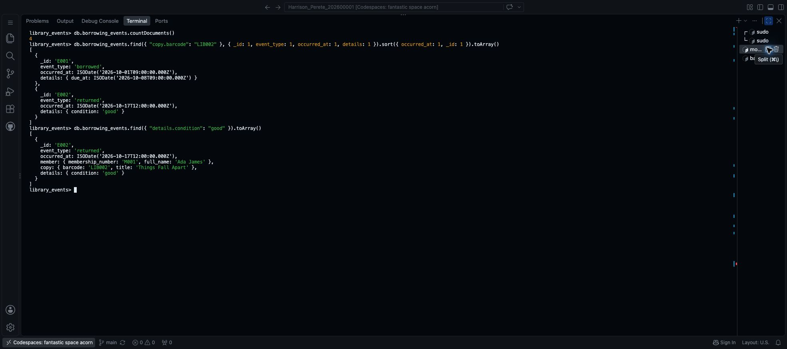

# Step 17 Store and query library events in MongoDB

Portfolio 4 in Section 4 of the [assessment brief](https://lms-assets.miva.university/course-materials/mit-8103-advanced-database-systems-ca-september-cohort-2026.pdf) requires a NoSQL model for the same case study, implementation evidence and an explanation of suitability.

Use your MongoDB connection from Step 16—**local MongoDB or Atlas**. The commands below work with either. They go in **mongosh**, not PostgreSQL or the `$` terminal.

The library example is below. For another case study, use the adaptable prompt at the end **before running the library commands**.

## 1. Choose what a document stores

Store one library event per document: a copy being borrowed or returned.

- **Database:** a named space for the work, here `library_events`.
- **Collection:** a group of documents, here `borrowing_events`—similar to a table.
- **Document:** one record, such as Ada returning LIB002.
- **Field:** one named piece of information, such as `event_type`.

| Field | Library example |
| --- | --- |
| `_id` | A unique event ID, such as E002. This is not a loan ID. |
| `event_type` | borrowed or returned |
| `occurred_at` | When the event happened |
| `member` | The member number and name, grouped together |
| `copy` | The barcode and book title, grouped together |
| `details` | Due date for a borrowing; condition for a return |

`member`, `copy` and `details` contain smaller documents inside the event. This is called **embedding**. Borrowing and return events share the main fields, but their `details` differ.

These are fictional example events using the same library members and copies. Entering them in MongoDB does not change PostgreSQL or create an automatic connection between the two databases.

## 2. Select your MongoDB database

In mongosh, run:

```javascript
db = db.getSiblingDB("library_events")
```

Expected: `library_events`, with a prompt such as `library_events>`. For another case study, use your chosen MongoDB database name. It does not need to match your PostgreSQL database name.

Check that the collection is empty:

```javascript
db.borrowing_events.countDocuments()
```

Expected before inserting: **0**. If it is not zero, stop and check whether you already ran this exercise. Do not delete existing documents to force the expected result.

## 3. Insert four example documents

Copy this **complete block** and run it once:

```javascript
db.borrowing_events.insertMany([
  {
    _id: "E001", event_type: "borrowed",
    occurred_at: ISODate("2026-10-01T09:00:00Z"),
    member: { membership_number: "M001", full_name: "Ada James" },
    copy: { barcode: "LIB002", title: "Things Fall Apart" },
    details: { due_at: ISODate("2026-10-08T09:00:00Z") }
  },
  {
    _id: "E002", event_type: "returned",
    occurred_at: ISODate("2026-10-17T12:00:00Z"),
    member: { membership_number: "M001", full_name: "Ada James" },
    copy: { barcode: "LIB002", title: "Things Fall Apart" },
    details: { condition: "good" }
  },
  {
    _id: "E003", event_type: "borrowed",
    occurred_at: ISODate("2026-10-17T14:00:00Z"),
    member: { membership_number: "M002", full_name: "Ben Cole" },
    copy: { barcode: "LIB003", title: "Things Fall Apart" },
    details: { due_at: ISODate("2026-10-24T14:00:00Z") }
  },
  {
    _id: "E004", event_type: "borrowed",
    occurred_at: ISODate("2026-10-15T09:00:00Z"),
    member: { membership_number: "M002", full_name: "Ben Cole" },
    copy: { barcode: "LIB001", title: "Things Fall Apart" },
    details: { due_at: ISODate("2026-10-22T09:00:00Z") }
  }
])
```

Expected: **`acknowledged: true`**, with IDs **E001, E002, E003 and E004**. MongoDB creates the database and collection when these documents are first saved. `ISODate` stores a date value; `Z` means UTC.

If you get a duplicate-key error, check for an earlier run rather than changing the IDs and inserting again.

## 4. Run three queries

Maximise the terminal and press **Ctrl+L** so the following results fit in one screenshot. Run each query separately.

### Count the documents

```javascript
db.borrowing_events.countDocuments()
```

Expected: **4**.

### Read a copy's event history

```javascript
db.borrowing_events.find(
  { "copy.barcode": "LIB002" },
  { _id: 1, event_type: 1, occurred_at: 1, details: 1 }
).sort({ occurred_at: 1, _id: 1 }).toArray()
```

`copy.barcode` means the barcode inside `copy`. The second group selects fields to display; `1` means include. `sort` puts the events in date order, and `toArray()` displays the results together.

Expected:

| ID | Event | Date (UTC) | Details |
| --- | --- | --- | --- |
| E001 | borrowed | 2026-10-01 09:00 | due_at: 2026-10-08 09:00 |
| E002 | returned | 2026-10-17 12:00 | condition: good |

### Find returns marked good

```javascript
db.borrowing_events.find({ "details.condition": "good" }).toArray()
```

Expected: **one complete document, E002**—Ada James returning LIB002, with `details: { condition: "good" }`.

Take **one screenshot** showing the count and both query results. Name it `Surname_Firstname_StudentID_P4_EventsAndQueries.png`, using your own details. Keep `.jpg` if it was saved as JPEG.

- Mac: **Cmd+Shift+4**. Windows: **Win+Shift+S**, then save.
- Rename the image, then upload it to your existing `portfolio-4-nosql/screenshots` folder through Explorer → right-click the folder → **Upload…**.



Together with Step 16, that is **two screenshots for Portfolio 4**.

## 5. Save the JavaScript and README

In `portfolio-4-nosql`, create `Surname_Firstname_StudentID_P4_MongoDB.js` and save your database selection, inserts and three queries, with short comments. Use `.js`, not `.sql`: these are MongoDB shell commands.

The complete [library script](Harrison_Perete_202600001_P4_MongoDB.js) includes a check that stops if records already exist. It also uses `printjson(...)` to show results when run as a saved script. You have already inserted the documents, so do not run the whole script again in this database.

Now open the **existing Portfolio 4 README** created in Step 3. Add the following sections using your own case, model and actual results. Keep any existing work rather than pasting duplicate headings.

````markdown
# Portfolio 4 NoSQL and Advanced Data Models

## Document model
The library_events database contains a borrowing_events collection.
Each document records one borrowing or return event. Its fields are _id,
event_type, occurred_at, member, copy and details. Member number/name
and copy barcode/title are embedded in the event. Borrowing details
contain a due date; return details contain a condition.

Example return document:

```javascript
{
  _id: "E002", event_type: "returned",
  occurred_at: ISODate("2026-10-17T12:00:00Z"),
  member: { membership_number: "M001", full_name: "Ada James" },
  copy: { barcode: "LIB002", title: "Things Fall Apart" },
  details: { condition: "good" }
}
```

## Implementation and results
Four fictional documents are inserted using mongosh. The count is 4.
The LIB002 history query returns E001 (borrowed) and E002 (returned).
Searching details.condition for good returns E002, Ada's LIB002 return.
The events are entered separately; PostgreSQL is not changed.

## Why MongoDB fits
An event can keep its member, copy and event-specific details together.
Borrowing and return details can differ without requiring every event
to have every field. A separate document per event lets the history grow
without adding everything to one large document. The copied names and
titles are snapshots and do not automatically track SQL changes.
PostgreSQL still handles the lending rules. This example does not enforce
SQL foreign keys in MongoDB or synchronise the two databases.

## Files
[Link your MongoDB.js, Setup.md and screenshots/ folder.]

## References
[Link the MongoDB documentation used below.]
````

The data represents sample events, not a complete audit history or a query for current availability. The field structure is a design choice here; this exercise does not add a schema validator.

The [completed library README](https://github.com/arizonal2014/Harrison_Perete_202600001/blob/main/portfolio-4-nosql/Harrison_Perete_202600001_P4_README.md) also includes a sample document so the model can be seen directly.

## Prompt for your own case study

```text
Help me complete MIT 8103 Portfolio 4 with MongoDB for my existing case.

MY CASE AND FICTIONAL RECORDS
[ATTACH MY PORTFOLIO 1 README, SCHEMA AND SAMPLE-DATA SQL FILES.]

MY MONGODB CONNECTION
[STATE LOCAL MONGODB OR ATLAS. DO NOT INCLUDE PASSWORDS.]

MY FILE PREFIX
[ENTER THE Surname_Firstname_StudentID PREFIX USED ON MY EXISTING FILES.]

Use the library event example's size and structure, adapted to my case:
- One database name and one collection for activity/event records.
- Four fictional documents representing two suitable event types.
- Shared fields for event ID, type and time; small embedded documents
  for related details; one details section that varies by event type.
- Use relevant identifiers from my supplied records. Explain that these
  are separate MongoDB examples, not automatically extracted SQL data.
- Use fixed dates and unique string _id values. Do not change PostgreSQL.

Return a short field table, the four documents, and mongosh commands to
select the database, check the collection is empty, insert once, and run
three queries: total count, one entity's ordered event history, and one
nested-field filter. Provide expected results derived from those documents.
Show the four documents inside one insertMany block, not as duplicate
standalone blocks. Use my prefix for the P4_MongoDB.js filename.
Use the same commands for local MongoDB and Atlas after connecting.
Include brief explanations and one screenshot checkpoint for the queries.
Do not delete existing data or invent execution results.

Keep the model small; do not add an application, login, replication or
extra collections. If essential input is missing, ask for it first.
After I run the commands and supply the outputs, help me write a short
README with these headings: Document model; Implementation and results;
Why MongoDB fits; Files; References. Include one example document.
Start it with # Portfolio 4 NoSQL and Advanced Data Models.
Use actual results, real relative file links, a suitability explanation
and a limitation. Do not copy the library facts into my different case.
```

Run the generated commands and paste their results into the same AI chat before requesting the README. Do not describe predicted results as observed results.

## 6. Save to GitHub

Save the files with **Cmd+S** or **Ctrl+S**. Use the separate `$` terminal for Git—not mongosh:

```bash
git diff --check
git diff
git add portfolio-4-nosql/
git diff --cached --stat
git commit -m "Add MongoDB event model and query evidence"
git push origin main
git status
```

Press **q** to leave a scrolling diff. Check the staged file list before committing. On GitHub, open the README, script and two screenshots. Do not upload connection credentials or MongoDB's working-data folder.

References: [MongoDB data modelling](https://www.mongodb.com/docs/manual/data-modeling/), [inserting documents](https://www.mongodb.com/docs/manual/reference/method/db.collection.insertmany/) and [querying nested fields](https://www.mongodb.com/docs/manual/tutorial/query-embedded-documents/).

**Portfolio 4 evidence:** the document model and suitability explanation in the README, the JavaScript implementation, setup notes and two screenshots.

**Next: [Step 18 — Explain distributed and cloud databases](18_Explain_Distributed_And_Cloud_Databases.md).**

[Back to Step 16](16_Set_Up_MongoDB.md)
