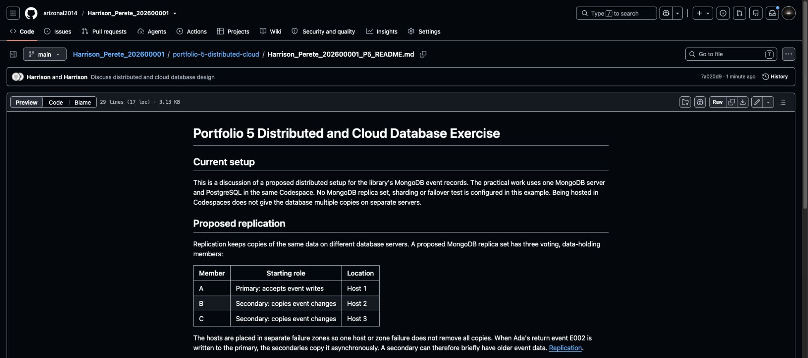

# Step 18 Explain distributed and cloud databases

Portfolio 5 is worth **6 marks**. Section 4 of the [assessment brief](https://lms-assets.miva.university/course-materials/mit-8103-advanced-database-systems-ca-september-cohort-2026.pdf) permits a **discussion or setup** based on the same case study, covering relevant distributed/cloud concepts such as replication, sharding, availability and consistency.

This example takes the **discussion route**. No extra installation or cloud purchase is needed. Save a short, case-related discussion and **one screenshot** of it on GitHub. Do not present a proposed design as a working deployment.

## 1. Start with the system you already built

The library uses PostgreSQL for lending records and MongoDB for example events. So far, both run in one Codespace. That is not a multi-server database setup.

If you used Atlas, describe that instead. Use your actual setup notes; do not guess the number of replica members or claim a failover test you have not run.

The discussion answers: **How could the library keep its event records available if a database server failed?**

## 2. Write the discussion in your Portfolio 5 README

Open `portfolio-5-distributed-cloud`, then your existing `Surname_Firstname_StudentID_P5_README.md` from Step 3. Use your own filename prefix.

For the library example, add the following. For another case study, use the prompt below to adapt it.

```markdown
# Portfolio 5 Distributed and Cloud Database Exercise

## Current setup

This is a discussion of a proposed distributed setup for the library's
MongoDB event records. The practical work uses one MongoDB server and
PostgreSQL in the same Codespace. No MongoDB replica set, sharding or
failover test is configured in this example. Being hosted in Codespaces
does not give the database multiple copies on separate servers.

## Proposed replication

Replication keeps copies of the same data on different database servers.
A proposed MongoDB replica set has three voting, data-holding members:

| Member | Starting role | Location |
| --- | --- | --- |
| A | Primary: accepts event writes | Host 1 |
| B | Secondary: copies event changes | Host 2 |
| C | Secondary: copies event changes | Host 3 |

The hosts are placed in separate failure zones so one host or zone
failure does not remove all copies. When Ada's return event E002 is
written to the primary, the secondaries copy it asynchronously. A
secondary can therefore briefly have older event data.
[Replication](https://www.mongodb.com/docs/manual/replication/).

## Failure and consistency

If A fails, the two remaining members can elect an eligible secondary
as the new primary, provided they can communicate and form a majority.
New writes pause during the election, so failover is not instant or
guaranteed without the required members. If only one of the three
voting members remains reachable, there is no majority to elect a
writable primary.
[Elections](https://www.mongodb.com/docs/v8.0/core/replica-set-elections/).

For important events, the proposed design requests majority write
acknowledgement: at least two of these three voting, data-holding
members must acknowledge the write. This improves protection against
losing an acknowledged event during a single-member failure, but adds
waiting and requires a reachable majority. Recent-event queries prefer
the primary; secondary reports may lag. Current copy availability still
comes from PostgreSQL and its transaction rules, not from a possibly
stale event copy.
[Write concern](https://www.mongodb.com/docs/v8.0/reference/write-concern/).

## Sharding and cloud deployment

Sharding splits records across groups of servers; replication copies
the same records. Four example events do not justify sharding. If event
volume grows enough to exceed one replica set's practical capacity,
shard-key selection needs evidence about query patterns and data
distribution. No sharding is implemented here.
[Sharding](https://www.mongodb.com/docs/manual/sharding/).

A cloud version could use a suitable managed MongoDB deployment, with
database authentication, encrypted connections, restricted network
access and scheduled backups that are tested by restoring them.
Available features and costs need checking for the chosen deployment.
Replication does not replace backups: an accidental deletion can also
reach the copies. MongoDB replication alone does not protect the whole
library service; PostgreSQL needs its own availability and recovery
plan. It also does not automatically synchronise the two databases.
[Atlas backup options](https://www.mongodb.com/docs/atlas/backup-restore-cluster/).
```

In simple terms: the **primary** takes writes, **secondaries** keep copies, **failover** changes the primary after a failure, and **sharding** divides records rather than copying the whole set. Tie these ideas to your own records, not just definitions.

## 3. Prompt for your own case study

Attach your existing files—you do not need to invent a new system or work out cloud settings first.

```text
Help me write MIT 8103 Portfolio 5 using the discussion option.

MY CASE AND ACTUAL SETUP
[ATTACH MY PORTFOLIO 1 README, PORTFOLIO 4 README AND MONGODB
SETUP NOTES. DO NOT INCLUDE CONNECTION PASSWORDS.]

Use this title and exactly these headings:
# Portfolio 5 Distributed and Cloud Database Exercise
## Current setup
## Proposed replication
## Failure and consistency
## Sharding and cloud deployment

Keep the discussion under 500 words, excluding references. Use simple
language and my actual case, not renamed library sentences.

- Current setup: state only what my files show. If the actual topology
  is unclear, say it is not verified; do not guess node counts or tests.
- Proposed replication: suggest three voting, data-holding MongoDB
  members on separate hosts/failure zones. Include a table with Member,
  Starting role and Location. Use one of my event types as the example.
- Failure and consistency: explain a primary failure, election, brief
  write interruption, and what happens without a reachable majority.
  Explain majority write acknowledgement and possible secondary lag.
  Keep operational decisions with the appropriate authoritative database.
- Sharding and cloud deployment: distinguish splitting records from
  copying them. Explain whether my small example needs sharding.
  Mention authentication, encryption, restricted access, backup/restore,
  cost and a limitation. Do not imply MongoDB replication also replicates
  PostgreSQL or automatically synchronises the two databases.

Clearly distinguish proposals from work actually implemented. Do not
invent deployments, test results, failover times or performance figures.
Return Markdown suitable for my existing P5_README.md. No installation
commands, new features, extra files or personal reflection are needed.

Use these official sources and place relevant links near the claims:
https://www.mongodb.com/docs/manual/replication/
https://www.mongodb.com/docs/v8.0/core/replica-set-elections/
https://www.mongodb.com/docs/v8.0/reference/write-concern/
https://www.mongodb.com/docs/manual/sharding/
https://www.mongodb.com/docs/atlas/backup-restore-cluster/
If you cannot verify a source, state that rather than inventing support.
```

Read the result against your setup notes. Keep the proposed design labelled as proposed. Save the README with **Cmd+S** or **Ctrl+S**.

## 4. Save to GitHub

Use the `$` terminal, not PostgreSQL or mongosh. Run each line separately, replacing the example filename with yours:

```bash
git diff --check
git diff -- portfolio-5-distributed-cloud/
git add portfolio-5-distributed-cloud/Harrison_Perete_202600001_P5_README.md
git diff --cached --stat
git commit -m "Discuss distributed and cloud database design"
git push origin main
```

Press **q** if the diff opens in a scrolling view. Check the staged filename before committing. Open the README on GitHub and check the table and reference links.

## 5. Save one screenshot

Take **one screenshot** of your GitHub README showing the proposed member table and part of the discussion. It records the written proposal, **not a running replica set**.

- Mac: **Cmd+Shift+4**. Windows: **Win+Shift+S**, then save.
- Name it `Surname_Firstname_StudentID_P5_Discussion.png`, using your own details. Keep `.jpg` if your image is JPEG.
- In Codespaces Explorer, create `screenshots` inside `portfolio-5-distributed-cloud`.
- Right-click that folder → **Upload…** and select the renamed image.



Save the uploaded image to GitHub from the `$` terminal:

```bash
git add portfolio-5-distributed-cloud/screenshots/
git diff --cached --stat
git commit -m "Add Portfolio 5 discussion screenshot"
git push origin main
git status
```

The [completed library discussion](https://github.com/arizonal2014/Harrison_Perete_202600001/blob/main/portfolio-5-distributed-cloud/Harrison_Perete_202600001_P5_README.md) uses the same structure. The README is the main evidence for this discussion route; the screenshot does not replace it.

**Portfolio 5 evidence:** a case-related distributed/cloud discussion, a proposed member table, references and one screenshot. No replica-set experiment has been claimed.

**Next: [Step 19 — Prepare the final 2-3-page summary](19_Prepare_The_Final_Summary.md).**

[Back to Step 17](17_Model_And_Query_MongoDB.md)
