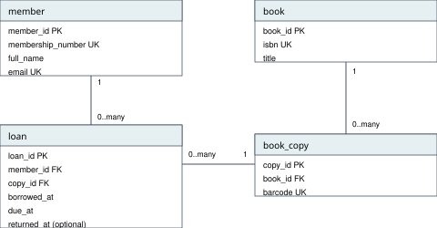

# MIT 8103 Advanced Database Systems: Portfolio Summary

**Library Borrowing System** | Perete Harrison | Student ID: 202600001 (demonstration ID)

Worked example. Replace the identity, results, reflection and declaration with your own before submission.

GitHub: [arizonal2014/Harrison_Perete_202600001](https://github.com/arizonal2014/Harrison_Perete_202600001)

## Case study

The library records members, books, physical copies and loans. Staff register members, issue copies, record returns and check availability or overdue loans. Members borrow and return copies. The example covers one branch using fictional records. PostgreSQL holds lending records; MongoDB holds sample borrowing and return events. Both run in one GitHub Codespace.

## Portfolio 1: Database Design and Modelling

The relational design has four tables: member, book, book_copy and loan. Separating books from physical copies allows several copies to share one title. Each table has a primary key. Foreign keys connect copies to books and loans to existing members and copies. Unique values identify membership numbers, emails, ISBNs and barcodes. Date checks reject invalid borrowing and return dates. A unique partial index permits only one open loan per copy [1].

The normalisation examples show a borrowing list becoming one borrowing per row in 1NF. Copy details are separated from the combined borrowing key in 2NF. Member details and book titles move to their own tables in 3NF. The schema, ER diagram and normalisation tables are saved in Portfolio 1. Six invalid inserts are rejected by the intended rules. At that stage, the records contain two members, one book, three copies and three loans.

Figure 1. The four tables and their relationships. PK identifies a row, FK links tables and UK marks a unique value. Each loan belongs to one member and one copy; each copy belongs to one book. A member, copy or book can have zero or many related records.

<!-- PAGE BREAK -->

## Portfolio 2: Query Processing and Optimisation

Three queries retrieve open loans, available copies and loan counts per member. At this stage, there are two open loans; LIB003 is available; Ada has two loans and Ben has one. A separate table contains 100,000 generated closed-loan records for the speed test, leaving the original lending records unchanged.

The same date-range count returns 24 before and after an index on borrowed_at. EXPLAIN (ANALYZE, BUFFERS) records the plan and actual execution [2]. After one warm-up in each phase, three measured runs give:

| Measurement | Before index | After index |
| --- | --- | --- |
| Scan | Seq Scan | Index Only Scan |
| Median execution time | 7.941 ms | 0.039 ms |
| Shared buffer hits, third run | 960 | 3 |

The index avoids scanning unrelated dates in this test. These cached, shared-Codespace measurements do not predict every workload. Indexes also require storage and maintenance.

## Portfolio 3: Transactions and Concurrency

A return for LIB002 is saved with COMMIT. Repeating the conditional return changes zero rows. In another transaction, a valid LIB003 loan is followed by an invalid due date. ROLLBACK removes the unsaved loan while keeping the earlier committed return.

Two sessions then use READ COMMITTED [3]. Session A inserts a LIB003 loan for Ben without committing. Session B cannot see that uncommitted loan and tries to lend the same copy to Ada. Its insert waits. After A commits, B receives a duplicate-key error from loan_one_open_copy and rolls back. The final result is one open LIB003 loan, belonging to Ben. This shows why an earlier availability check alone is insufficient. The index enforces the one-open-loan rule during concurrent inserts. The conditional return demonstrates the update workflow, not protection against every possible direct edit.

## Portfolio 4: NoSQL and Advanced Data Models

MongoDB stores four documents in library_events.borrowing_events. Each event embeds member and copy details, a date and event-specific details. A borrowing contains a due date; a return contains the copy's condition. This keeps the information for one event together [4].

The insert is acknowledged for E001-E004, and the count is four. The LIB002 query returns its borrowing followed by its return. Searching details.condition for good returns E002, Ada's return. These are separately entered sample events, not automatic PostgreSQL synchronisation or a complete audit log. Embedded names are snapshots. PostgreSQL remains responsible for lending constraints.

<!-- PAGE BREAK -->

## Portfolio 5: Distributed and Cloud Database Exercise

The discussion proposes three voting, data-holding MongoDB replica members on separate hosts and failure zones. A primary accepts event writes; secondaries copy changes. If a primary fails, a reachable majority can elect an eligible replacement. Writes pause during the election. Majority acknowledgement and possible secondary lag affect durability, availability and recent-event reads [5].

Sharding divides records rather than copying the full set. Four sample events do not justify it. A managed cloud deployment would also need authentication, encryption, restricted access and tested backups. Replication does not replace backups or protect PostgreSQL automatically. This is a proposed design: no replica set, sharding or failover experiment was implemented.

## Evidence

Scripts, explanations and screenshots: [P1 design and tests](https://github.com/arizonal2014/Harrison_Perete_202600001/tree/main/portfolio-1-database-design), [P2 plans and timings](https://github.com/arizonal2014/Harrison_Perete_202600001/tree/main/portfolio-2-query-optimisation), [P3 transactions](https://github.com/arizonal2014/Harrison_Perete_202600001/tree/main/portfolio-3-transactions-concurrency), [P4 events](https://github.com/arizonal2014/Harrison_Perete_202600001/tree/main/portfolio-4-nosql), [P5 proposal](https://github.com/arizonal2014/Harrison_Perete_202600001/tree/main/portfolio-5-distributed-cloud). Earlier screenshots record earlier database states; Portfolio 3 changes the original loans.

## Individual reflection

Example only. Replace this paragraph with your own design choice, difficulty, action and lesson.

Separating books from copies makes the lending rule easier to express. The two-session example shows a less obvious problem: a copy can appear available while another session has an uncommitted loan. Checking the waiting session and the final duplicate-key error explains why the unique index matters. The query comparison also shows that the same correct result can involve different amounts of work. Testing other date ranges and index maintenance costs would make the performance analysis more useful.

## References

[1] PostgreSQL Global Development Group. PostgreSQL 16: Constraints. https://www.postgresql.org/docs/16/ddl-constraints.html

[2] PostgreSQL Global Development Group. PostgreSQL 16: Using EXPLAIN. https://www.postgresql.org/docs/16/using-explain.html

[3] PostgreSQL Global Development Group. PostgreSQL 16: Transaction Isolation. https://www.postgresql.org/docs/16/transaction-iso.html

[4] MongoDB. Data Modeling in MongoDB. https://www.mongodb.com/docs/manual/data-modeling/

[5] MongoDB. Replication. https://www.mongodb.com/docs/manual/replication/

Accessed 17 October 2026. Additional topic-specific references appear in the portfolio READMEs. The lending data is fictional; the benchmark records are generated by the saved SQL.

## AI-use declaration

Sample only: use this if AI guided you and you executed the work yourself.

“I used [AI tool name] to explain database concepts and help review the structure and wording of my portfolio. I executed the database commands myself, checked the results against the assessment requirements and corrected issues before submission. I understand the work and remain responsible for its accuracy.”

Replace the tool name. Include any help with scripts, analysis or execution if used. Only claim checks you personally completed.
