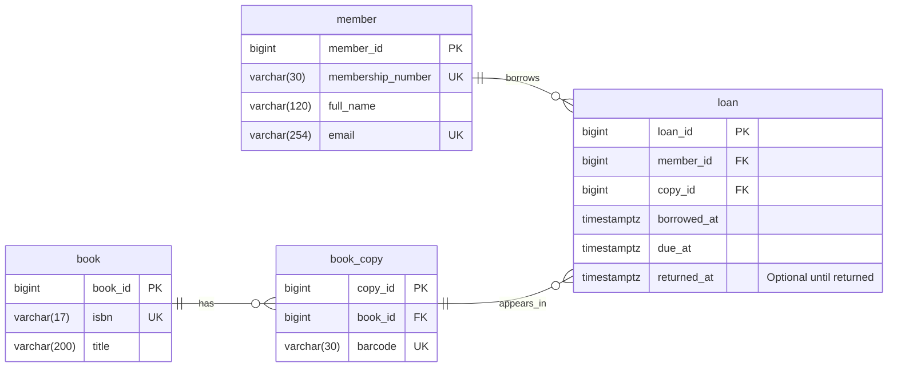

# Library Borrowing System ER Diagram

This diagram shows the four tables, their fields and how they connect.

## Reading the diagram

- **PK** identifies one record. **FK** links to another table. **UK** means a value is unique.
- `||` means exactly one. `o{` means zero or many.
- A book can have zero or many physical copies. Each copy belongs to one book.
- A member can have zero or many loans. Each loan belongs to one member.
- A copy can appear in zero or many loans over time. Each loan refers to one copy.

For example, copy 10 can be borrowed in January and again in February. These are two separate loan records.

All fields are required except returned_at. The diagram shows loan history; the separate rule allowing only one open loan per copy is covered in the database design. Date checks and return rules are also described there.
